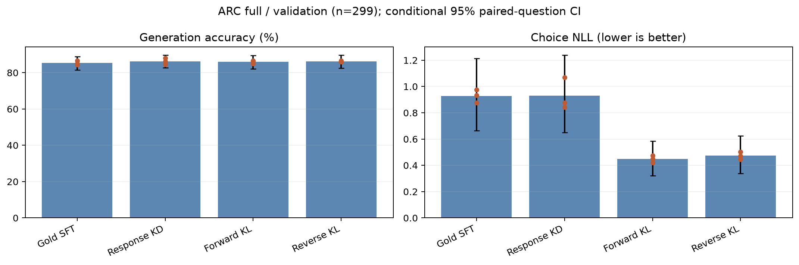

# 연구보고서 v3.0

<!-- main-status:start -->
**진행 상태:** 사용자 요청으로 실험 중단. 전체 train 학습 13/18회 완료, validation 검증·집계 12/18회 완료. 고정 혼합 seed 42는 학습 완료·validation 미완료이며 최종 test는 미평가다. [중단 상태 기록](outputs/kl_extension/status.json)
<!-- main-status:end -->

## 핵심 설계

주 질문은 **confidence 기반 적응형 KL 혼합이 고정 50:50 혼합보다 나은가**다. 본문은 Accuracy·선택지 NLL·paired 95% CI로 정리하고, 신뢰도·오류·gate·비용은 보조 자료로 둔다. [고정 설계](RESEARCH_PLAN.md)

| 항목 | 실험 설정 |
|---|---|
| Teacher | Qwen3.5-9B, NF4 double quantization + BF16 compute, 동결 |
| Student | Qwen3.5-2B, BF16 원본 동결 + FP32 LoRA, 학습 가능 8,409,600개 |
| 본실험 입력 | ARC-Challenge train 1,118개 전체 |
| 조건·반복 | Gold·Response·Forward·Reverse·고정 혼합·적응형 혼합 × seed 42·7·123 |
| 학습 | 각 조건을 원본부터 3 epochs·420 steps, 고정 epoch 3 |
| 평가 | validation 299개 / 동결 후 test 1,172개 전체 |

Student 학습은 BF16+LoRA다. Teacher만 양자화했고 Student QLoRA는 수행하지 않는다. Train/validation/test의 원본 ID·전체 입력 hash 교집합은 0이며, 3·4·5개 선택지를 유지했다. [입력 기록](outputs/pilot/data_manifest.json)

## 준비·검증 완료

- Teacher의 전체 train 응답·T=2 전체 어휘 cache **1,118개 생성 완료**. 정답 일치 1,066개(95.35%), 오답 52개도 모두 보존했다. 형식 오류·잘림 0건.
- FP32 log-probability cache는 **1,110,487,136 bytes (약 1.03 GiB)**. 기존 파일럿 256개와 겹치는 답변·확률분포가 완전히 일치했다.
- Teacher·원본 Student·기존 9개 adapter의 validation 신뢰도 측정 완료. 기존 생성 답변도 모두 재현했다.
- KL 수식·gradient·hard gate·EOS·불완전 batch 정규화 검사를 통과했다. 범위 변경 후 검사는 새 프로토콜에 기록한다.

[Teacher 생성 기록](outputs/kl_extension/targets/full/summary.json) · [겹치는 신호 검증](outputs/kl_extension/target_overlap_check.json) · [self-check](outputs/kl_extension/self_check.json) · [동결 프로토콜](outputs/kl_extension/training_protocol.json)

## 파일럿 요약: 탐색 기록

아래 수치는 train 256개·validation 299개·3 seeds의 결과다. 전체 train 본실험과 섞어 비교하지 않는다.

| 조건 | Accuracy 평균±seed SD | 선택지 NLL |
|---|---:|---:|
| Gold SFT | 82.05±1.65% | 0.9829 |
| Response KD | 83.61±0.33% | 1.1744 |
| Forward KL | 84.28±0.58% | 0.5296 |
| Reverse KL | 83.72±0.19% | 0.5614 |

Reverse−Forward Accuracy는 −0.56%p, 조건부 95% CI −1.90~+0.89%p로 Reverse의 우위를 확인하지 못했다. Forward−Response의 Brier·NLL·ECE는 개선 방향이었지만 Accuracy 우위는 미확인이다. 탐색적 validation 분석이며 본실험 결론이 아니다. Teacher validation 오답 22개와 원본 Student 정답 7개 subset의 오류 분석도 보조 기록에 둔다.

남은 파일럿은 종료했다. 진행 중이던 고정 혼합 seed 42는 **64/96 steps에서 중단**했고 중간 로그를 보존했다. 최종 adapter·완료 결과로 사용하지 않는다. 완료된 Reverse 세 seed와 이전 실험 산출물은 보존했다.

[파일럿 수치·검증](outputs/kl_extension/analysis/reverse_validation_interim/comparison.json) · [파일럿 학습곡선·그래프](outputs/kl_extension/analysis/reverse_validation_interim/index.html)

<!-- kl-results-live:start -->
## 본실험 중간 결과: 12/18 검증·집계 완료

네 조건을 각각 seed 42·7·123에서 전체 train 1,118개로 3 epochs·420 steps 학습하고, 저장 adapter를 다시 불러와 validation 299개를 평가했다. 모든 실행의 adapter·평가 파일 hash, 매 epoch 전체 문항 사용, 같은 seed의 초기 adapter·문항 순서와 유한한 손실/gradient를 확인했다. 형식 오류·잘림은 0건이다.

| 모델·조건 | Accuracy | 선택지 NLL ↓ |
|---|---:|---:|
| Teacher NF4 | 92.64% (277/299) | 0.2436 |
| 원본 Student | 76.25% (228/299) | 0.5918 |
| Gold SFT, 3 seed 평균±SD | **85.28±1.21%** | **0.9288±0.0491** |
| Response KD, 3 seed 평균±SD | **86.29±1.67%** | **0.9296±0.1233** |
| Forward KL, 3 seed 평균±SD | **85.95±0.88%** | **0.4475±0.0263** |
| Reverse KL, 3 seed 평균±SD | **86.18±0.39%** | **0.4738±0.0287** |

| 탐색적 비교 | Accuracy 차이·95% CI (%p) | 선택지 NLL 차이·95% CI |
|---|---:|---:|
| Reverse−Forward | +0.22 [-1.23, +1.67] | +0.0263 [-0.0021, +0.0556] |
| Forward−Gold | +0.67 [-1.78, +3.12] | -0.4813 [-0.6618, -0.3132] |
| Forward−Response | -0.33 [-2.34, +1.67] | -0.4821 [-0.6764, -0.3070] |

Reverse−Forward는 Accuracy·NLL 구간 모두 0을 포함해 우열을 확인하지 못했다. Forward는 Gold·Response보다 세 seed 모두 NLL이 낮고, 탐색적 구간도 개선 방향이지만 Accuracy 우위는 미확인이다. Gold·Response는 원본 Student보다 Accuracy가 높아졌으나 NLL은 악화됐다. Accuracy와 확률 품질을 구분해 해석한다.

CI는 같은 문항을 모든 조건·seed에서 함께 5,000회 재표집한 구간이며 관측한 세 학습 seed에 조건부다. SD는 seed 표본 표준편차(ddof=1)다. 897개 독립 문항으로 계산하지 않았다. 위 비교는 **미조정 탐색적 중간 결과**이며, 주 비교인 적응형−고정 혼합과 최종 test는 아직 미완료다. 고정 혼합 seed 42의 학습은 이후 완료됐지만 validation은 미완료다. 현재는 사용자 요청으로 중단했으며, 남은 학습은 5회·validation은 6회다. 고정 epoch 3 기준을 유지한다.

성능 그림은 전체 validation 299개·각 3 seeds이며 점은 개별 seed, 오차 막대는 문항 bootstrap CI다. 학습곡선은 seed 42의 고정 train/validation **각 64개**에서 측정한 공통 Gold CE·Accuracy다. 최적화 손실은 조건별 목적함수이며 직접 크기를 비교하지 않는다. 진단 후 adapter 가중치가 같고, 최종 64개 validation 답변·log-probability가 전체 재평가와 정확히 일치했다.

[4 조건·3 seed 수치와 paired CI](outputs/kl_extension/analysis/full_reverse_validation_interim/comparison.json) · [학습 손실·신뢰도·오류·비용 그래프](outputs/kl_extension/analysis/full_reverse_validation_interim/index.html) · [12회 학습·평가·보존 검증](outputs/kl_extension/analysis/full_training_progress/through_reverse_validation_verified.json)
<!-- kl-results-live:end -->

## 보조 자료와 한계

학습곡선은 seed 42의 고정 train·validation 각 64개 진단 subset에서 측정한다. 최종 validation/test 성능은 전체 문항을 사용한다. Brier·ECE·gate 분기·Teacher 오류·gradient·추론 비용은 JSON·그래프 갤러리에 보관한다. Train 오류 진단과 held-out 문항 분석을 분리하고 subset 분자/분모를 표시한다.

현재는 한 모델 조합·영어 ARC·첫 답변 위치의 증류 실험이다. 공개 checkpoint의 ARC 사전 노출은 미확인이다. [CaRE-KD](https://arxiv.org/html/2609.36734v1)의 혼합 손실 적용 비교로서 신규 알고리즘이나 전체 프레임워크 재현을 주장하지 않는다. Confidence가 높아도 Teacher가 틀릴 수 있고, CI가 0을 포함하는 결과는 동등성의 증거가 아니다.

[범위 변경·보존 기록](outputs/kl_extension/scope_change.json) · [원본 산출물 목록](outputs/kl_extension/preservation.json) · [중단 상태 기록](outputs/kl_extension/status.json)
