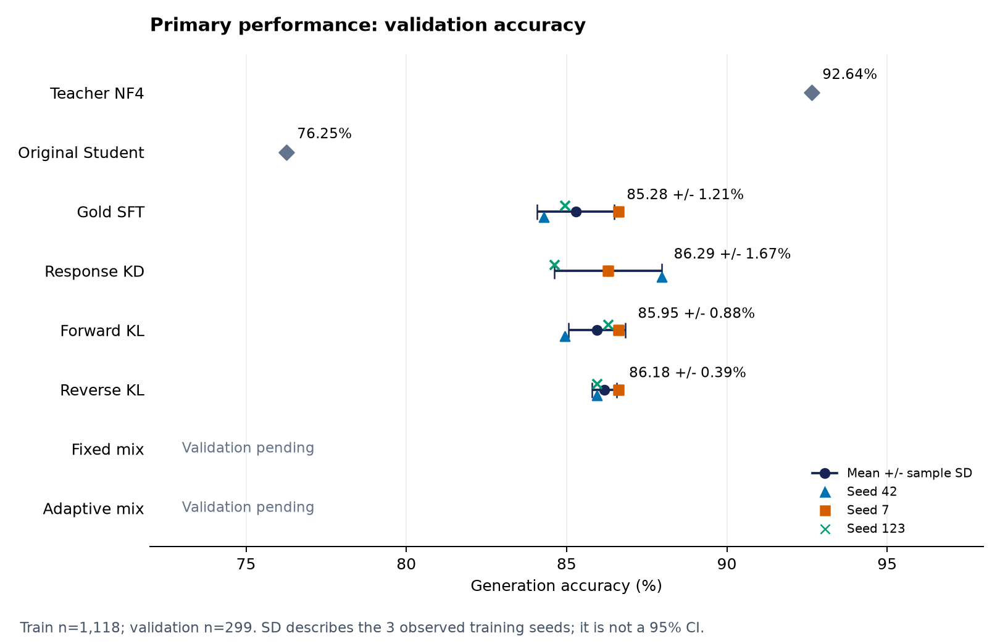
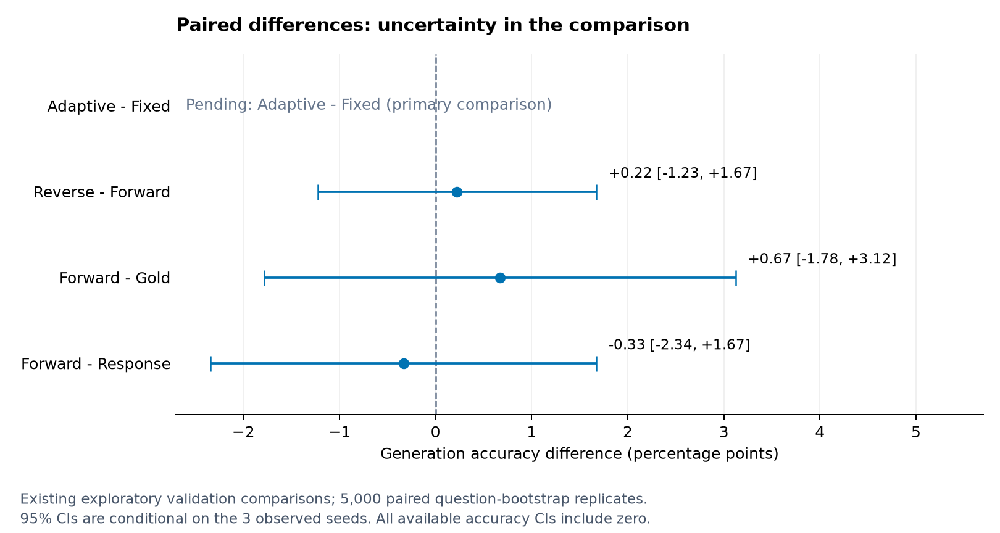
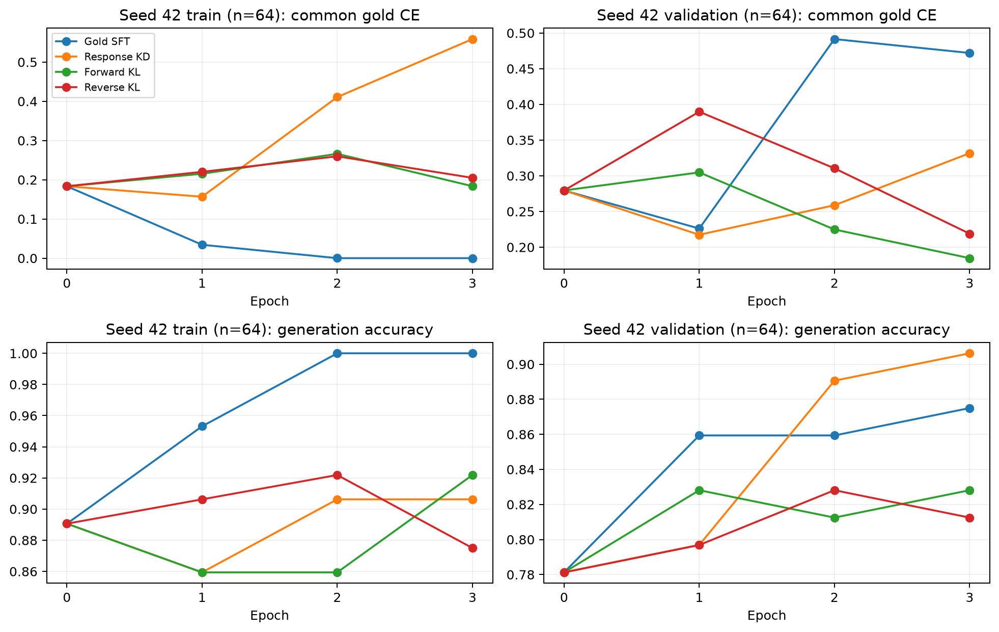

# 연구보고서 v4.0 · 계획 개정 및 기존 결과 기록

<!-- main-status:start -->
**진행 상태:** 사용자 요청으로 실험 중단. 전체 train 학습 13/18회 완료, validation 검증·집계 12/18회 완료. 고정 혼합 seed 42는 학습 완료·validation 미완료이며 최종 test는 미평가다. [중단 상태 기록](../results/protocols/status.json)
<!-- main-status:end -->

## 2026-10-12 계획 개정

사용자 제공 PDF에 따라 [연구계획서 v4.0](RESEARCH_PLAN.md)은 **Hard−Soft의 Accuracy·시간 효율성**을 주 연구로 하고 E7을 추가한 7조건×3 seeds로 개정했다. Fixed 대비 두 비교는 핵심 대조다. E7은 미구현·미학습이며 현재 실행 코드는 기존 6조건 전용이다. 온도 산정·detach·시간 범위·목표 80%의 전체 validation 도달 관측을 새 동결 대상에 포함했다.

아래 실험·수치·그래프는 **기존 v3.2의 6조건 기록**이다. 기존 13/18 학습·12/18 검증을 새 21회 진행률로 표시하지 않는다. 호환성 확인 시 남은 본실험 학습은 8회, 시간 측정용 Fixed seed 42 재현은 별도 1회다. 기존 최종 adapter를 바꾸지 않고 원본 프로토콜과 산출물을 보존한다. [계획 변경 이력](../results/protocols/research_revision_v4.json)

## 기존 v3.2의 핵심 설계

기존 v3.2의 주 질문은 **confidence 기반 적응형 KL 혼합이 고정 50:50 혼합보다 정답률을 높이는가**였다. 본문은 생성 Accuracy·개별 seed·평균±SD와 **적응형−고정 혼합의 Accuracy 차이·paired 95% CI**를 중심으로 구성한다. Gate 분기·Teacher 오류·학습곡선은 해석 분석, 선택지 NLL은 보조 성능, ECE·Brier·비용은 부록이다. [개정 평가 정의·동결 원칙](RESEARCH_PLAN.md#evaluation)

| 항목 | 실험 설정 |
|---|---|
| Teacher | Qwen3.5-9B, NF4 double quantization + BF16 compute, 동결 |
| Student | Qwen3.5-2B, BF16 원본 동결 + FP32 LoRA, 학습 가능 8,409,600개 |
| 본실험 입력 | ARC-Challenge train 1,118개 전체 |
| 조건·반복 | Gold·Response·Forward·Reverse·고정 혼합·적응형 혼합 × seed 42·7·123 |
| 학습 | 각 조건을 원본부터 3 epochs·420 steps, 고정 epoch 3 |
| 평가 | validation 299개 / 동결 후 test 1,172개 전체 |

Student 학습은 BF16+LoRA다. Teacher만 양자화했고 Student QLoRA는 수행하지 않는다. Train/validation/test의 원본 ID·전체 입력 hash 교집합은 0이며, 3·4·5개 선택지를 유지했다. [입력 기록](../results/protocols/data_manifest.json)

## 방법을 해석하는 기준

Gold는 실제 정답으로 학습한 SFT 기준선이고 Response는 Teacher가 생성한 답변을 hard label로 모방한다. Forward·Reverse·고정 혼합·적응형 혼합은 T=2 전체 어휘의 soft distribution을 이용한다. Forward와 Reverse는 불일치를 각각 Teacher와 Student 확률로 가중하며, 고정 혼합은 둘을 매번 50:50으로 평균하고 적응형은 상대 entropy confidence로 한 방향을 선택한다. [6개 방식의 수식·예시·차이와 선행연구](RESEARCH_PLAN.md#methods)

네 KL 조건은 같은 EOS CE·Temperature·학습량을 사용한다. 적응형 gate는 정답 판별기나 Teacher 오류 필터가 아니며 Reverse도 동결 Teacher를 목표로 Student를 학습한다. 따라서 효과의 주 판단은 Accuracy 차이와 불확실성으로 하고 NLL·gate·오류 패턴으로 해석을 보완한다. 현재 검증·집계된 것은 Gold·Response·Forward·Reverse의 각 3 seeds뿐이며 두 혼합의 비교는 미완료다.

## 준비·검증 완료

- Teacher의 전체 train 응답·T=2 전체 어휘 cache **1,118개 생성 완료**. 정답 일치 1,066개(95.35%), 오답 52개도 모두 보존했다. 형식 오류·잘림 0건.
- FP32 log-probability cache는 **1,110,487,136 bytes (약 1.03 GiB)**. 기존 파일럿 256개와 겹치는 답변·확률분포가 완전히 일치했다.
- Teacher·원본 Student·기존 9개 adapter의 validation 신뢰도 측정 완료. 기존 생성 답변도 모두 재현했다.
- KL 수식·gradient·hard gate·EOS·불완전 batch 정규화 검사를 통과했다. 범위 변경 후 검사는 새 프로토콜에 기록한다.

[Teacher 생성 기록](../results/protocols/teacher_targets_summary.json) · [겹치는 신호 검증](../results/checks/target_overlap_check.json) · [self-check](../results/checks/self_check.json) · [동결 프로토콜](../results/protocols/training_protocol.json)

## 파일럿 요약: 탐색 기록

아래 수치는 train 256개·validation 299개·3 seeds의 결과다. 전체 train 본실험과 섞어 비교하지 않는다.

| 조건 | Accuracy 평균±seed SD | 선택지 NLL |
|---|---:|---:|
| Gold SFT | 82.05±1.65% | 0.9829 |
| Response KD | 83.61±0.33% | 1.1744 |
| Forward KL | 84.28±0.58% | 0.5296 |
| Reverse KL | 83.72±0.19% | 0.5614 |

Reverse−Forward Accuracy는 −0.56%p, 조건부 95% CI −1.90~+0.89%p로 Reverse의 우위를 확인하지 못했다. Forward−Response의 Brier·NLL·ECE는 개선 방향이었지만 Accuracy 우위는 미확인이다. 탐색적 validation 분석이며 본실험 결론이 아니다. Teacher validation 오답 22개와 원본 Student 정답 7개 subset의 오류 분석도 보조 기록에 둔다.

남은 파일럿은 종료했다. 진행 중이던 고정 혼합 seed 42는 **64/96 steps에서 중단**했고 중간 로그를 보존했다. 최종 adapter·완료 결과로 사용하지 않는다. 완료된 Reverse 세 seed와 이전 실험 산출물은 보존했다.

[파일럿 수치·검증](../results/pilot/comparison.json) · [파일럿 학습곡선·그래프](../results/pilot/index.html)

<!-- kl-results-live:start -->
## 본실험 중간 결과: 12/18 검증·집계 완료

네 조건을 각각 seed 42·7·123에서 train 1,118개로 3 epochs·420 steps 학습하고 저장 adapter를 다시 불러와 validation 299개를 평가했다. Adapter·평가 hash, 매 epoch 전체 문항 사용, 같은 seed의 초기 adapter·문항 순서와 유한한 손실/gradient를 확인했다. 형식 오류·잘림은 0건이다. 아래는 **validation 중간 결과**이며 최종 test 결론이 아니다.

### 1. 주 성능: 정답률과 학습 반복 변동

Teacher NF4는 **92.64% (277/299)**, 원본 Student는 **76.25% (228/299)**다. 두 기준 모델은 학습 반복이 없는 참조 결과로 seed SD를 계산하지 않는다.

| 조건 | seed 42 | seed 7 | seed 123 | 평균±seed SD |
|---|---:|---:|---:|---:|
| Gold SFT | 84.28% | 86.62% | 84.95% | **85.28±1.21%** |
| Response KD | 87.96% | 86.29% | 84.62% | **86.29±1.67%** |
| Forward KL | 84.95% | 86.62% | 86.29% | **85.95±0.88%** |
| Reverse KL | 85.95% | 86.62% | 85.95% | **86.18±0.39%** |
| 고정 혼합 | 평가 미완료 | 미완료 | 미완료 | 미집계 |
| 적응형 혼합 | 미완료 | 미완료 | 미완료 | 미집계 |

SD는 세 학습 seed의 표본 표준편차(ddof=1)다. 그림의 오차 막대는 **seed SD이며 95% CI가 아니다**. Gold·Response·Forward·Reverse 모두 원본 Student보다 평균 정답률이 높지만 이 표만으로 방법 사이의 우위를 판단하지 않는다.

### 2. 비교 판단: Accuracy 차이와 paired CI

**기존 주 비교인 적응형−고정 혼합은 아직 미완료**다. 고정 혼합 seed 42는 학습만 완료됐고 validation은 미완료다. 아래 세 비교는 기존에 지정한 탐색적 중간 비교다.

| 비교 | 평균 차이 (%p) | paired 95% CI (%p) | 해석 |
|---|---:|---:|---|
| Reverse−Forward | +0.22 | [-1.23, +1.67] | 우위 미확인 |
| Forward−Gold | +0.67 | [-1.78, +3.12] | 우위 미확인 |
| Forward−Response | -0.33 | [-2.34, +1.67] | 우위 미확인 |

같은 문항을 모든 조건·seed에서 함께 5,000회 재표집했다. CI는 관측한 세 seed에 조건부이며 학습 seed 전체 모집단의 변동까지 포함하지 않는다. 299개 문항을 897개 독립 문항으로 계산하지 않았다. 현재 구간은 모두 0을 포함하므로 Accuracy 우위는 미확인이고, '차이가 없다'거나 동등하다는 결론도 내리지 않는다.

### 3. 보조 성능: 정답에 부여한 확률

| 모델·조건 | 선택지 NLL ↓ (학습 조건은 평균±seed SD) |
|---|---:|
| Teacher NF4 | 0.2436 |
| 원본 Student | 0.5918 |
| Gold SFT | 0.9288±0.0491 |
| Response KD | 0.9296±0.1233 |
| Forward KL | 0.4475±0.0263 |
| Reverse KL | 0.4738±0.0287 |

Forward는 Gold·Response보다 세 seed 모두 NLL이 낮고 기존 탐색적 차이 CI도 개선 방향이다. 그러나 Accuracy 우위는 미확인이다. Gold·Response는 원본 Student보다 Accuracy가 높지만 NLL은 나빠졌다. **정답률과 확률 품질을 구분하는 근거**이며 NLL 개선을 주 연구 질문의 성공으로 대체하지 않는다. NLL은 T=1 첫 step의 유효 선택지 확률로 계산하며 calibration만 측정하는 값이 아니다. [정의·한계](RESEARCH_PLAN.md#evaluation) · [기존 NLL·Brier·ECE와 모든 탐색적 CI](../results/main/comparison.json)

### 4. 해석 분석: gate와 Teacher 오류

적응형은 아직 학습하지 않아 **실제 gate 분기 비율은 보고할 수 없다**. 단독 Forward·Reverse 로그의 entropy gate 값은 가상 분기 진단이며 적응형의 관측 결과로 쓰지 않는다.

Validation의 Teacher 오답 22개 중 원본 Student가 맞춘 것은 7개다. 아래 수치는 **seed 42 · 7 · 123 순서의 개수**이며 train Teacher 오답 52개와 다른 문항 집합이다.

| 조건 | Teacher 오답을 맞춤 (각 /22) | Teacher와 같은 오답 (각 /22) | 원본 Student 정답을 잃음 (각 /7) |
|---|---:|---:|---:|
| Gold SFT | 7 · 7 · 9 | 12 · 14 · 12 | 2 · 3 · 2 |
| Response KD | 11 · 8 · 9 | 8 · 12 · 11 | 1 · 3 · 1 |
| Forward KL | 8 · 9 · 10 | 11 · 10 · 10 | 3 · 2 · 1 |
| Reverse KL | 6 · 9 · 10 | 13 · 11 · 10 | 3 · 2 · 1 |

분모가 작고 동일 문항을 반복 관찰하므로 기술적 패턴만 해석한다. Gold도 Teacher 오답을 맞추거나 원본 정답을 잃을 수 있어 이 표만으로 Teacher 오류의 인과적 전달이나 gate의 개선 효과를 증명하지 않는다. [오류 그래프](../results/main/teacher_errors.png)

### 5. 학습 진단

Seed 42의 고정 train/validation **각 64개 subset**에서 측정한 공통 Gold CE·Accuracy다. Train subset은 실제 학습 문항에 포함된다. 서로 다른 optimizer 목적함수의 loss 크기는 직접 비교하지 않는다. 진단 후 adapter 가중치가 같고 최종 64개 validation 답변·log-probability가 전체 재평가와 일치했다. 이 곡선은 최종 validation/test 전체 성능이나 최적 checkpoint 선택을 대신하지 않는다.

현재 사용자 요청으로 중단했으며 남은 학습은 5회·validation은 6회다. 고정 epoch 3과 미평가 test를 유지한다.

[검증된 원 수치](../results/main/comparison.json) · [주 성능→비교→해석→보조 자료 순서의 갤러리](../results/main/index.html) · [12회 학습·평가·보존 검증](../results/checks/through_reverse_validation_verified.json)
<!-- kl-results-live:end -->

## 보조 자료와 한계

기존 Accuracy·NLL 결합 그림, NLL·Brier·ECE의 탐색적 구간, gradient·시간·VRAM·모델 크기는 JSON·부록 갤러리에 모두 보존한다. 본문에서 지표의 역할을 구분해도 불리한 기존 결과를 삭제하지 않는다. 이번 정리는 중간 validation을 확인한 후 이루어진 보고 변경이며 원본 프로토콜·평가 계산·주 비교는 그대로다. [보고 변경 기록](../results/protocols/reporting_review.json)

현재는 한 모델 조합·영어 ARC·첫 답변 위치의 증류 실험이다. 공개 checkpoint의 ARC 사전 노출은 미확인이다. [CaRE-KD](https://arxiv.org/html/2609.36734v1)의 혼합 손실 적용 비교로서 신규 알고리즘이나 전체 프레임워크 재현을 주장하지 않는다. Confidence가 높아도 Teacher가 틀릴 수 있고, CI가 0을 포함하는 결과는 동등성의 증거가 아니다.

[범위 변경·보존 기록](../results/protocols/scope_change.json) · [원본 산출물 목록](../results/protocols/preservation.json) · [중단 상태 기록](../results/protocols/status.json)

## 디렉토리 정리 기록

코드는 `src/`, 문서는 `docs/`, 공개할 중간 결과는 `results/`, 의존성은 `requirements/`에 묶었다. 기존 `outputs/`·데이터·cache·adapter와 원본 동결 프로토콜은 로컬에 보존했다. 학습·손실·평가 수식은 바꾸지 않았으며 소스·문서 경로와 hash 검증의 경로 변경 호환 처리만 수정했다. [변경 전후 소스 hash와 경로 기록](../results/protocols/layout_migration.json)
