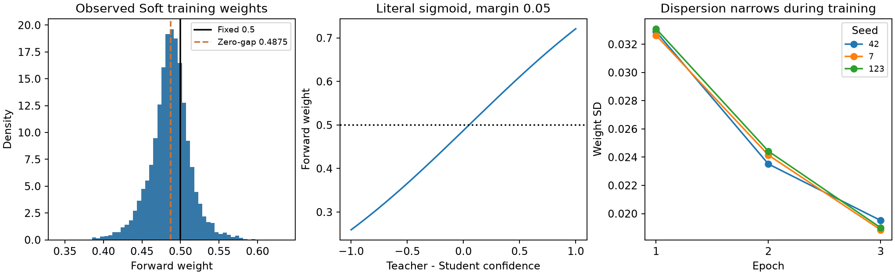
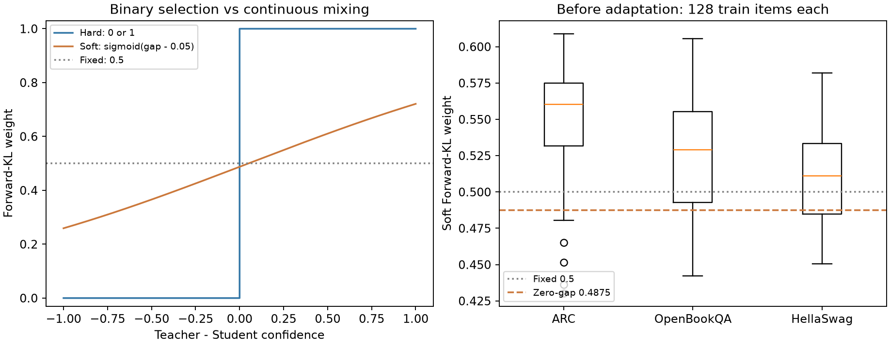
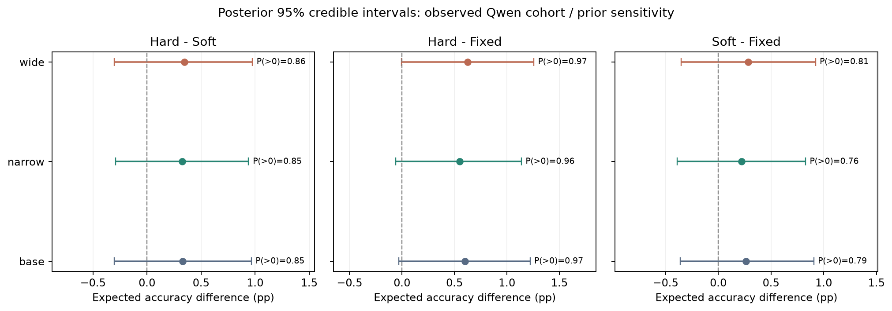
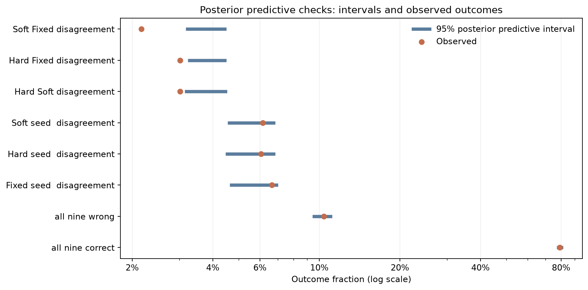

# 연구보고서

v4.3 ARC 본실험과 2026-10-13의 Bayesian·gate·새 데이터 진단을 정리했다. **Hard−Soft의 우위는 미확인**이며, 현재 후속 작업은 이진 선택과 연속 가중의 차이를 다른 데이터에서 검토하는 것이다.

<!-- main-status:start -->
**v4.3 완료:** 본실험 21개 학습·validation과 Teacher·원본 Student·21개 adapter의 test 1,172개 평가 완료. Fixed seed 42 시간 재현 1회는 별도이며 원본 최종 checkpoint를 유지했다. Test 이후 재학습·checkpoint 변경은 수행하지 않았다.
<!-- main-status:end -->

## 1. 완료 실험의 범위

| 항목 | 실제 수행 |
|---|---|
| 모델 | Qwen3.5-9B NF4 Teacher / Qwen3.5-2B BF16·FP32 LoRA Student |
| 데이터·반복 | ARC train 1,118·validation 299·test 1,172, 7조건×seed 42·7·123 |
| 학습·평가 | 독립 학습 21개·고정 epoch 3·420 steps; baseline 포함 test 모델 23개 |
| 별도 시간 측정 | Fixed seed 42 재현 1회; 기존 성능 adapter 유지 |
| Teacher train 신호 | 정답 1,066/1,118(95.35%), 오답 52개 유지; soft cache 약 1.03 GiB |

세부 수식과 통제값은 [연구계획서](RESEARCH_PLAN.md#methods), 데이터·소스·checkpoint는 [test manifest](../results/protocols/gate_test_manifest.json)에 둔다.

<!-- gate-final-results:start -->
## 2. ARC-Challenge 최종 성능·시간

Teacher 93.86%, 원본 Student 79.35%. 아래 세 seed의 SD와 paired 문항 CI는 서로 다른 불확실성이다.

| 조건 | Test Accuracy 평균±SD | seed 42 / 7 / 123 | 선택지 NLL |
|---|---|---|---|
| Gold SFT | 84.16±0.30% | 84.13% / 83.87% / 84.47% | 1.0417 |
| Response KD | 84.95±0.63% | 84.47% / 85.67% / 84.73% | 1.1187 |
| Forward KL | 84.98±0.15% | 84.90% / 84.90% / 85.15% | 0.4918 |
| Reverse KL | 85.18±0.40% | 84.73% / 85.49% / 85.32% | 0.5060 |
| Fixed 50:50 | 84.76±0.20% | 84.64% / 84.64% / 84.98% | 0.5004 |
| Adaptive hard gate | 85.38±0.20% | 85.49% / 85.49% / 85.15% | 0.4994 |
| Adaptive soft gate | 85.04±0.21% | 85.07% / 85.24% / 84.81% | 0.5064 |

| 비교 | Accuracy 차이 | paired 95% CI |
|---|---|---|
| Adaptive hard gate − Adaptive soft gate | +0.34%p | [-0.23, +0.91]%p |
| Adaptive hard gate − Fixed 50:50 | +0.63%p | [+0.08, +1.19]%p |
| Adaptive soft gate − Fixed 50:50 | +0.28%p | [-0.17, +0.74]%p |

주 비교의 CI가 0을 포함해 Hard와 Soft의 Accuracy 우위를 확인하지 못했다. 동등성을 입증한 것은 아니다. Hard−Fixed·Soft−Fixed는 사전 지정 보조 비교이며 미조정 탐색적 CI다. 모든 CI는 관측한 세 학습 seed에 조건부이며 seed 모집단까지 포괄하지 않는다.

| 측정 조건 | 학습 시간 평균±SD | seed 42 / 7 / 123 |
|---|---|---|
| Fixed 50:50 | 31.24±2.50분 | 28.66 / 31.42 / 33.65분 |
| Adaptive hard gate | 29.44±2.53분 | 29.05 / 27.12 / 32.14분 |
| Adaptive soft gate | 29.30±2.65분 | 28.03 / 27.52 / 32.34분 |

시간은 모델/Teacher/cache 로딩·epoch 진단·최종 평가를 제외하고 학습 loop·로그·최종 저장을 포함한다. 기존 E1~E4 시간은 다른 날짜의 기술적 참조이며 위 동일 측정 cohort와 직접 순위를 합치지 않는다. Fixed seed 42 시간은 재현 run, 최종 성능은 기존 adapter에서 측정했다. 재현 tensor hash 일치: True; final validation 답변 불일치: 0개.

**시간 해석 한계:** 공유 데스크톱에서 측정했고 다른 앱의 GPU 활동도 관측했다. 이전 run 전체의 부하 이력·영향은 미측정이므로 알고리즘 자체의 속도 우위를 분리한 결과로 주장하지 않는다. [관측 기록](../results/checks/timing_environment_snapshot.json)

[CI 그림](../results/gate_comparison_v4/test/paired_ci.png) · [정확도–시간 그림](../results/gate_comparison_v4/test/time_accuracy.png) · [NLL·ECE·Brier·오류 분모·자원 상세값](../results/gate_comparison_v4/test/comparison.json)
<!-- gate-final-results:end -->

<!-- validation-complete:start -->
Validation 299개에서 Fixed **85.28±1.00%**, Hard **86.51±0.84%**, Soft **85.51±1.17%**였다. Test와 구분한 보조 관측이며 checkpoint 선택에 사용하지 않았다. [전체 validation 결과·곡선](../results/gate_comparison_v4/validation/comparison.json)
<!-- validation-complete:end -->

## 3. Soft는 실제로 얼마나 연속적으로 변했는가

기존 Soft train 3-seed 로그의 평균은 **0.4866**, SD는 **0.0260**, 가운데 90%는 **0.442~0.527**이었다. 모든 seed에서 epoch 1의 SD 약 0.033이 epoch 3의 약 0.019로 줄었다. 10,062회 기록은 같은 문항·epoch의 반복 관측이며 독립 표본 수나 신뢰구간으로 취급하지 않는다.

Hard는 confidence 차이가 0 이상이면 Forward 100%, 음수면 Reverse 100%다. Soft는 `sigmoid(cp-cq-0.05)`로 연속 혼합하고 차이가 0이면 약 0.4875다. 50:50 부근에 집중됐다는 해석은 타당하지만 Fixed와 같은 결과라는 뜻은 아니다. 평균 기울기 `g(1-g)`는 **0.2491**이어서 sigmoid gradient 소실로 해석할 수 없고 selection gradient도 유지한다. 로그의 scalar coefficient를 parameter gradient norm이라고 부르지 않았다.

[평균·분위수·수식·기울기 진단](../results/gate_continuity/original_gate_audit.json). Hard−Soft에는 margin·selection gradient 차이도 있으므로 현재 결과를 연속성 하나의 인과 효과로 해석하지 않는다.

## 4. 다른 데이터: 확보·학습 전 진단 완료

| 데이터 | 원본 train / validation | 정제 train 후보 | 품질 검사 |
|---|---|---|---|
| OpenBookQA main | 4,957 / 500 | 4,907 | train 동일 입력 중복 42건·validation 겹침 7문항·정답 선택지 불일치 1그룹(2개 ID) |
| HellaSwag | 39,905 / 10,042 | 39,905 | 동일 입력 중복·분할 겹침 0; 재사용되는 ind는 출처+번호로 구분 |

두 데이터의 train·validation만 확보했다. 원본 Parquet 합계 **29.79 MiB**, 정규화 JSONL 합계 **71.03 MiB**다. 원본은 보존하고 중복·겹침·정답 충돌을 train 후보에서 제외했다. 기존 ARC 분할과 동일 전체 입력의 겹침은 0개이며 의미상 중복·모델 사전 노출까지 배제한 검사가 아니다. OpenBookQA 추가 fact1은 입력하지 않는다. [분할·revision·EDA·hash](../results/gate_continuity/datasets.json) · [정성 검토용 train 샘플](../results/gate_continuity/review_samples.json)

각 train에서 성능과 무관하게 고정한 **128문항**을 기존 Teacher·원본 Student로 순차 진단했다. 중립적인 공통 문구·native template·T=2 전체 어휘 entropy를 사용했고 768회 forward·prefix 최대 356 tokens로 잘림은 없었다.

| train 표본 | Teacher / Student 문자 정답률 | Soft 평균 / SD | 가중치 5~95 분위수 | Hard Forward 비율 |
|---|---|---|---|---|
| ARC-Challenge | 93.75% / 78.12% | 0.5520 / 0.0343 | 0.492~0.597 | 95.3% |
| OpenBookQA | 86.72% / 70.31% | 0.5245 / 0.0402 | 0.457~0.588 | 76.6% |
| HellaSwag | 90.62% / 60.16% | 0.5093 / 0.0315 | 0.460~0.562 | 69.5% |

정답률은 train 표본의 T=1 유효 문자 argmax다. 기존 자유 생성 test 정확도·HellaSwag 공식 completion 점수와 직접 비교하지 않는다. 초기 ARC의 평균 0.5520과 학습된 Soft의 0.4866도 Student 상태·문구·문항 범위가 달라 직접적인 학습 전후 효과로 해석하지 않는다.

**데이터를 바꿔도 Soft의 변화 폭이 자동으로 커지지 않았다.** HellaSwag는 더 50:50에 가까웠고 SD도 ARC 진단보다 작았다. 선택지 entropy 공간의 별도 진단에서는 SD 0.0543~0.0601로 넓었지만 이는 confidence 측정 공간 변경이며, 더 넓은 비율이 증류 성능 개선을 뜻하지 않는다.

[입력 선정·수식 동결](../results/gate_continuity/protocol.json) · [진단 수치·raw score hash](../results/gate_continuity/train_screening.json) · [768 forward·입력·원본 보존 검증](../results/gate_continuity/verification.json)

<!-- bayesian-analysis:start -->

## 5. 베이지안 후속 분석

기존 test 관측 뒤 수행한 탐색적 사후 분석이다. 문항×seed×방법 계층모형에 기본·0.5배·2배 prior를 적용했다. 세 fit 모두 divergence 0·Rhat≤1.01·ESS≥400으로 수렴 검사를 통과했지만, **모든 prior에서 후방 예측 8개 중 방법 간 disagreement 3개를 과대 예측**했다. 수렴과 적합성은 다르므로 모형 결과를 확증 근거로 쓰지 않는다.

| 비교 | 기본 prior 사후평균 | 95% credible interval | P(차이>0) |
|---|---|---|---|
| Hard−Soft | +0.332%p | [−0.304,+0.964]%p | 85.2% |
| Hard−Fixed | +0.598%p | [−0.032,+1.221]%p | 96.7% |
| Soft−Fixed | +0.266%p | [−0.361,+0.905]%p | 79.3% |

Hard−Soft의 prior별 우위 확률은 85.0~85.9%였고 모든 사후 구간은 0을 포함했다. 공통 Dirichlet 문항 가중치의 **paired Bayesian bootstrap** 보조 검사는 +0.343%p, 95% 구간 [−0.242,+0.926]%p, P(차이>0)=87.8%였다. 관측한 세 seed에 조건부이며 새 seed 변동을 대신하지 않는다. 기존 paired CI와 함께 우위·동등성을 확정하기에 부족하다.

[전체 Bayesian 결과](../results/bayesian_v1/summary.json) · [paired bootstrap](../results/bayesian_v1/paired_accuracy_bayesian_bootstrap.json) · [효과 크기별 확률](../results/bayesian_v1/effect_thresholds.png) · [최종 검증](../results/checks/bayesian_final_verification.json)
<!-- bayesian-analysis:end -->

## 6. 오류·확률 품질의 보조 해석

세 seed를 합치면 Hard만 맞힌 59건·Soft만 맞힌 47건으로, 비슷한 평균 정확도가 같은 정오 패턴을 뜻하지 않는다. Test Teacher 오답 72개 중 원본 Student 정답은 17개였다. 반복 관측·작은 subset이므로 gate의 오류 방지 능력이나 오류 전달의 인과 효과를 입증하지 않는다. [문항별 정오 교체](../results/bayesian_v1/paired_errors.png)

Gold/Response의 평균 NLL 1.0417/1.1187 중 오답 손실 비중은 **98.85%/99.08%**였다. 높은 확신의 오답이 확률 품질 차이를 주로 설명하지만 이 사실만으로 과적합을 단정하지 않는다. 이 confidence는 T=1 유효 선택지 최대 확률이며 T=2 전체 어휘 entropy gate와 다르다. [NLL 분해](../results/bayesian_v1/nll_decomposition.png) · [상세 검사](../results/bayesian_v1/nll_bayesian_bootstrap.json)

전체 validation 곡선 9개 중 4개에서 마지막 epoch Accuracy가 이전 최고보다 0.33~2.01%p 내려갔지만 고정 epoch 3을 유지했다. Validation 299개와 서로 다른 loss만으로 과적합을 확정하지 않는다. [학습곡선 진단](../results/bayesian_v1/learning_curve_audit.json)

## 7. 미실행 항목·다음 단계

1. **새 데이터 학습:** 같은 Qwen·전체 어휘 confidence에서 데이터 2개×Fixed·Hard·Soft×seed 42의 6회 탐색. 전체 token 길이·train 예산·validation·prompt를 먼저 동결한다. 현재 증류 학습·validation 성능 비교·새 test는 미실행이다.
2. **다른 Student:** Qwen 1.882B·SmolLM2 1.711B·Granite 2.534B의 공식 tokenizer와 선택지 KD를 준비했다. **GPU 실행 검사는 성능 벤치마크가 아니며 원본 validation 벤치마크·9회 독립 본학습은 미수행이다.** Qwen–SmolLM2가 크기가 가까운 주 비교이고 Granite는 더 큰 보조 후보다. 같은 1,118문항×3회라도 실제 입력은 Qwen 378,609 / SmolLM2 446,763 / Granite 570,798 tokens이므로 동일 토큰 예산이라고 부르지 않는다. Qwen도 공통 선택지 KD로 다시 학습한다. [예산 실측](../results/checks/student_comparison_budget.json) · [tokenizer·GPU 검사](../results/protocols/choice_kd_setup.json)
3. **해석 범위:** 현재 3조건은 실제 방법 비교다. 연속성·평균 가중치·selection gradient의 원인을 분리하려면 상수 가중치와 detach 대조가 필요하며, 1 seed 탐색으로 안정적인 일반화를 확정하지 않는다.

## 8. 재현·보존 기록

21개 학습·validation과 23개 test, 문항·정답·확률·checkpoint hash, 5,000회 bootstrap 재현을 검증했다. 원본 130개 산출물(103+27)·동결 소스 12개·완료 adapter 21개를 보존했다. 이번 후속 진단의 데이터 변환 4개·기존 Soft loss/gradient 9개 검사도 통과했다. [ARC 최종 검증](../results/checks/gate_final_verification.json) · [후속 보존 검증](../results/gate_continuity/verification.json)

공개 checkpoint의 ARC 사전 노출·의미상 데이터 중복·공식 CaRE 실행 config는 미검증이다. 과거 학습 중간 상태는 본문에서 제거했으며 [기존 중간 수치](../results/main/comparison.json)·[파일럿 결과](../results/pilot/index.html)·[근거 점검](../results/protocols/evidence_audit.json)·Git 이력에 보존한다.

**현재 Teacher:** `Qwen/Qwen3.5-9B`, NF4 4-bit double quantization·BF16 compute, 가중치 동결. **현재 Student:** `Qwen/Qwen3.5-2B`, BF16 원본 동결·FP32 LoRA(rank 8, alpha 16) 학습. Fixed·Hard·Soft는 같은 원본 Student에서 각각 독립 시작한다. SmolLM2·Granite 본학습은 이후 단계다.

<!-- data-gates:start -->
## 현실적인 후속 범위 동결: 2026-10-14

**2개 데이터×Fixed·Hard·Soft×seed 42=6회 탐색 학습**으로 정했다. 각 train은 질문 단위 중복·validation 겹침·라벨 충돌을 제외한 1,118개, 3 epochs·420 steps이며 개발용 평가 500개를 사용한다. 기존 T=2·margin=0.05·BF16 LoRA·전체 어휘 KD·공통 EOS를 유지한다. Teacher·원본 Student의 개발용 기준선과 train 8문항의 gradient 크기를 먼저 측정한다.

HellaSwag는 공개 validation에서 질문·출처가 겹치지 않는 개발용 500개/최종 평가용 500개를 사전 분리했다. OpenBookQA는 공식 validation과 test를 쓰며, test는 6개 최종 adapter 동결 뒤 입력 겹침 제외 규칙을 적용하고 평가한다. 모든 평가는 T=1 선택지 문자 argmax/NLL로 통일하며 공식 completion 점수와 구분한다. 최종 평가 뒤 재학습·조건 변경은 하지 않는다.

원본 130개 산출물·12개 소스·21개 adapter는 보존한다. 다른 Student 9회와 추가 상수/detach 대조는 후속 단계로 둔다. 1 seed는 예산에 따른 탐색이며 안정적인 일반화를 확정하지 않는다. [실행·분할·코드 동결](../results/data_gates_v1/protocol.json) · [현재 상태](../results/data_gates_v1/status.json)
<!-- data-gates:end -->
