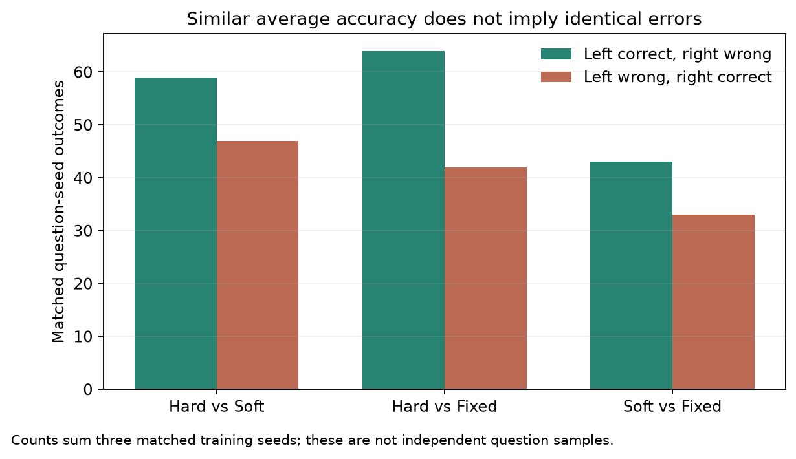
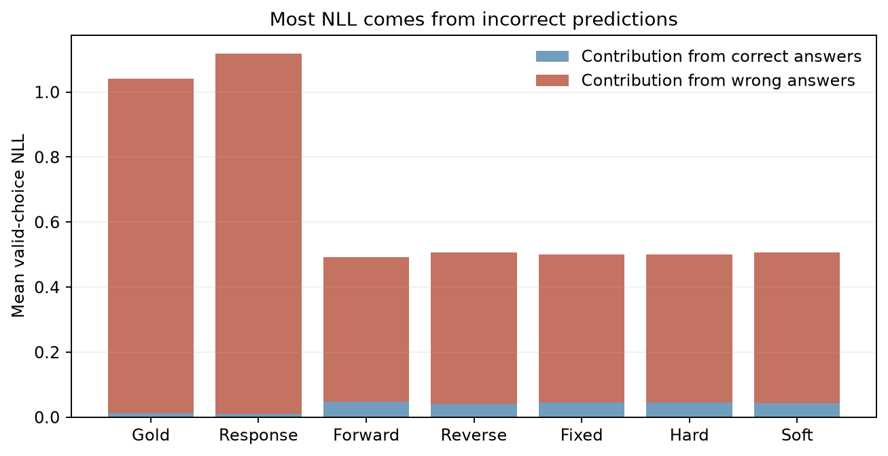

# 연구보고서 v4.3 · 증류 성능·시간 본실험 최종 결과

<!-- main-status:start -->
**v4.3 완료:** 본실험 21개 학습·validation과 Teacher·원본 Student·21개 adapter의 test 1,172개 평가 완료. Fixed seed 42 시간 재현 1회는 별도이며 원본 최종 checkpoint를 유지했다. Test 이후 재학습·checkpoint 변경은 수행하지 않았다.
<!-- main-status:end -->

<!-- gate-final-results:start -->
## v4.3 동결 test 최종 결과

Teacher 93.86%, 원본 Student 79.35%. 아래 세 seed의 SD와 paired 문항 CI는 서로 다른 불확실성이다.

| 조건 | Test Accuracy 평균±SD | seed 42 / 7 / 123 | 선택지 NLL |
|---|---|---|---|
| Gold SFT | 84.16±0.30% | 84.13% / 83.87% / 84.47% | 1.0417 |
| Response KD | 84.95±0.63% | 84.47% / 85.67% / 84.73% | 1.1187 |
| Forward KL | 84.98±0.15% | 84.90% / 84.90% / 85.15% | 0.4918 |
| Reverse KL | 85.18±0.40% | 84.73% / 85.49% / 85.32% | 0.5060 |
| Fixed 50:50 | 84.76±0.20% | 84.64% / 84.64% / 84.98% | 0.5004 |
| Adaptive hard gate | 85.38±0.20% | 85.49% / 85.49% / 85.15% | 0.4994 |
| Adaptive soft gate | 85.04±0.21% | 85.07% / 85.24% / 84.81% | 0.5064 |

| 비교 | Accuracy 차이 | paired 95% CI |
|---|---|---|
| Adaptive hard gate − Adaptive soft gate | +0.34%p | [-0.23, +0.91]%p |
| Adaptive hard gate − Fixed 50:50 | +0.63%p | [+0.08, +1.19]%p |
| Adaptive soft gate − Fixed 50:50 | +0.28%p | [-0.17, +0.74]%p |

주 비교의 CI가 0을 포함해 Hard와 Soft의 Accuracy 우위를 확인하지 못했다. 동등성을 입증한 것은 아니다. Hard−Fixed·Soft−Fixed는 사전 지정 보조 비교이며 미조정 탐색적 CI다. 모든 CI는 관측한 세 학습 seed에 조건부이며 seed 모집단까지 포괄하지 않는다.

| 측정 조건 | 학습 시간 평균±SD | seed 42 / 7 / 123 |
|---|---|---|
| Fixed 50:50 | 31.24±2.50분 | 28.66 / 31.42 / 33.65분 |
| Adaptive hard gate | 29.44±2.53분 | 29.05 / 27.12 / 32.14분 |
| Adaptive soft gate | 29.30±2.65분 | 28.03 / 27.52 / 32.34분 |

시간은 모델/Teacher/cache 로딩·epoch 진단·최종 평가를 제외하고 학습 loop·로그·최종 저장을 포함한다. 기존 E1~E4 시간은 다른 날짜의 기술적 참조이며 위 동일 측정 cohort와 직접 순위를 합치지 않는다. Fixed seed 42 시간은 재현 run, 최종 성능은 기존 adapter에서 측정했다. 재현 tensor hash 일치: True; final validation 답변 불일치: 0개.

**시간 해석 한계:** 공유 데스크톱에서 측정했고 다른 앱의 GPU 활동도 관측했다. 이전 run 전체의 부하 이력·영향은 미측정이므로 알고리즘 자체의 속도 우위를 분리한 결과로 주장하지 않는다. [관측 기록](../results/checks/timing_environment_snapshot.json)

전체 Teacher 준비 작업의 기존 시간은 hard 응답 생성과 soft 확률 추출을 함께 측정했으므로 소급 분리하지 않았다. 추론 지연은 고정 warmup 후 문항별 생성 측정이며 reference kernel 환경에 한정된다. 선택지 NLL·ECE·Brier·gate 분포·Teacher 오류 분모·자원 상세값은 [전체 결과](../results/gate_comparison_v4/test/comparison.json)에 보존한다. 공개 checkpoint의 ARC 사전 노출과 원문 실행 config의 scaling은 여전히 미검증이다.
<!-- gate-final-results:end -->

## 2026-10-12 계획 개정

사용자 제공 PDF에 따라 [연구계획서 v4.3](RESEARCH_PLAN.md)은 **Hard−Soft의 Accuracy·시간 효율성**을 주 연구로 하고 E7을 추가한 7조건×3 seeds로 개정했다. Fixed 대비 두 비교는 핵심 대조다. 2026-10-12 사용자 지적 후 원문을 대조해 임의 온도 선정·Soft detach를 철회했다. E7은 원문 sigmoid(confidence gap−m), m=0.05, selection gradient 유지로 수식을 구현했다. 새 7조건 실행기를 분리하고 원문 margin·gradient·시간 범위·전체 validation 관측 주기를 v4.3 프로토콜에 동결했다. 현재 실행 상태는 상단에, 실제 validation 중간 관측은 아래에 구분해 기록한다.

후반의 **기존 v3.2 절**에는 이전 6조건의 실험·수치·그래프를 보존한다. 기존 13회 학습·12회 검증은 새 동결 manifest에서 호환성 검사를 통과해 재사용한다. 동결 당시 추가 본실험 학습은 8회, 시간 측정용 Fixed seed 42 재현은 별도 1회로 계획했다. 기존 최종 adapter를 바꾸지 않고 원본 프로토콜과 산출물을 보존한다. [계획 변경 이력](../results/protocols/research_revision_v4.json)

## 2026-10-12 근거 대조 점검

CaRE-KD의 원본 PDF와 공개 HTML에서 gate 식·margin·selection gradient가 일치함을 확인했다. 공식 고정 revision의 9B·2B config는 로컬 cache와 byte 단위로 일치하며 공식 dataset card의 1,119/299/1,172 분할도 확인했다. 공개 Qwen checkpoint는 post-trained 모델이므로 원본 Student를 순수 pretraining Base 모델로 해석하지 않는다.

T=2·lr=2e−4·r=8·3 epochs·3 seeds는 기존 통제값이며 원문 default가 아니다. 첫 위치·EOS 손실도 과제 설계로 구분한다. 문헌 근거가 없는 목표 80%는 철회하고 정확도–시간 곡선과 총 학습 시간으로 비교한다. 5,000회 paired bootstrap은 기존 validation에서 재현됐으며 20,000회와의 Accuracy CI 끝점 차이는 최대 0.112%p였다. 최종 test나 학습 seed 불확실성에 대한 보장은 아니다. [근거·점검·조치 기록](../results/protocols/evidence_audit.json)

원문 PDF Figure 2의 개념도 기울기는 식 (3)의 unit sigmoid와 수치적으로 같지 않아 실제 코드의 scaling은 미확인으로 남겼다. 현재 구현은 공개 수식·gradient를 따르며 원문의 Soft 실험 설정을 정확히 재현했다고 주장하지 않는다. 그림에서 추가 온도를 생성하지 않았다.

### Soft GPU 검사 완료: 본실험과 분리

실제 NVIDIA GeForce RTX 5060 Ti에서 train 최장 입력 236 tokens, 전체 1,118개 prefix/cache 대응을 확인했다. 기존 설정의 8회 gradient 누적·1회 optimizer 갱신에서 유한한 loss/gradient와 LoRA 갱신을 확인했고 Teacher·원본 embedding은 동결됐다. Peak allocated VRAM은 3.69 GiB다. Adapter를 저장하거나 본학습에 재사용하지 않았으며 이것을 E7 완료 학습으로 세지 않는다. [실측 검사 결과](../results/checks/soft_gpu_probe.json)

`causal_conv1d`·`flash-linear-attention` 최적화 커널이 없어 실제 실행은 PyTorch reference fallback이었다. 계산 검사는 통과했지만 시간 결과는 이 고정 환경의 비교이며 최적 배포 속도로 일반화하지 않는다. 의존성이나 backend를 바꾸려면 시간 비교군 전체의 새 측정이 필요하다.

## v4.3 실행 동결·재개

22개 검사에서 기존 Fixed/Hard loss 호출 유지, 1,118개 문항 순서·140 steps/epoch, 마지막 6개 누적 gradient와 기존 optimizer 갱신 일치, 평가 RNG·모드 보존, 실패 run 덮어쓰기 방지를 확인했다. 새 Soft 학습 호출의 실제 GPU 검사도 8회 누적·1회 갱신을 통과했다. 검사 모델은 폐기했으며 학습 실적에 포함하지 않는다. [새 경로 검사](../results/checks/trainer_gpu_check.json)

원본 7개 소스·원본 프로토콜·130개 보호 산출물과 완료 adapter를 유지하고, 별도 v4 소스·runtime·설정·재사용 hash를 동결했다. 신규 학습 8회와 Fixed seed 42의 시간 측정 재현 1회를 순차 실행하도록 구성했다. 모든 epoch의 validation은 299개 전체이며, 저장한 최종 adapter를 다시 로딩해 검증한다. Fixed seed 42 성능 평가는 기존 adapter를 사용한다. [동결 manifest](../results/protocols/gate_training_protocol.json)

현재 GPU는 RTX 5060 Ti 16GB 1개, CPU는 Ryzen 5 7500F 6코어·12스레드다. 학습 시간의 비교 가능성을 위해 GPU 학습은 동시에 실행하지 않는다. 새 학습 실행기는 학습·validation 완료에서 종료하며, 별도 후속 프로세스가 test 동결·23개 모델 평가를 맡는다.

## v4.3 후속 평가 준비·학습 중간 관측

전체 33개 검사에서 test 조기 실행 차단, 21개 최종 adapter 검증·23개 평가 모델 구성, Fixed seed 42 재현 제외, 문항별 paired bootstrap, 보고서 재실행과 원본 보존을 확인했다. Test manifest 저장 경로 오류는 시험용 파일 검사에서 발견해 수정했으며 실제 baseline 기록은 변경되지 않았다. [후속 코드 검증](../results/checks/gate_evaluation_check.json)

평가 사전 동결 시점에 후속 프로세스를 학습·validation 완료를 기다리는 상태로 연결했다. 실행 순서는 모든 조건 검증 → checkpoint·소스·통계 동결 → 23개 모델 test → 통계·그림 → 문서 3개·Git 갱신이다. 예약 작업이나 heartbeat는 생성하지 않았다. 실제 test 진행 상태는 상단 snapshot에 표시한다. [평가·분석 사전 동결](../results/protocols/gate_evaluation_protocol.json)

## v4.3 전체 학습·validation 완료

<!-- validation-complete:start -->
7조건×3 seeds의 **본실험 21개**와 별도 Fixed seed 42 시간 재현 1회를 마쳤다. 아래는 **validation 299개**의 결과다. Teacher 92.64%, 원본 Student 76.25%. SD는 세 학습 seed의 표본 변동이며 문항 bootstrap CI와 구분한다.

| 조건 | Validation Accuracy 평균±SD | seed 42 / 7 / 123 | 선택지 NLL |
|---|---|---|---|
| Gold SFT | 85.28±1.21% | 84.28% / 86.62% / 84.95% | 0.9288 |
| Response KD | 86.29±1.67% | 87.96% / 86.29% / 84.62% | 0.9296 |
| Forward KL | 85.95±0.88% | 84.95% / 86.62% / 86.29% | 0.4475 |
| Reverse KL | 86.18±0.39% | 85.95% / 86.62% / 85.95% | 0.4738 |
| Fixed 50:50 | 85.28±1.00% | 85.28% / 86.29% / 84.28% | 0.4656 |
| Adaptive hard gate | 86.51±0.84% | 87.29% / 86.62% / 85.62% | 0.4601 |
| Adaptive soft gate | 85.51±1.17% | 86.62% / 85.62% / 84.28% | 0.4672 |

| Validation 비교 | Accuracy 차이 | paired 95% CI |
|---|---|---|
| Adaptive hard gate − Adaptive soft gate | +1.00%p | [-0.22, +2.34]%p |
| Adaptive hard gate − Fixed 50:50 | +1.23%p | [+0.22, +2.34]%p |
| Adaptive soft gate − Fixed 50:50 | +0.22%p | [-0.78, +1.23]%p |

주 비교 Hard−Soft의 CI는 0을 포함한다. Validation에서 우위를 확정하지 못했고 동등성을 입증한 것도 아니다. Hard−Fixed의 양의 구간은 사전 지정 보조 비교의 **미조정 탐색적 validation 결과**다. 모든 구간은 관측한 세 seed에 조건부이며, 최종 결론은 동결한 test 전체 결과에서 별도로 보고한다.

| 측정 조건 | 학생 학습 단계 시간 평균±SD | seed 42 / 7 / 123 |
|---|---|---|
| Fixed 50:50 | 31.24±2.50분 | 28.66 / 31.42 / 33.65분 |
| Adaptive hard gate | 29.44±2.53분 | 29.05 / 27.12 / 32.14분 |
| Adaptive soft gate | 29.30±2.65분 | 28.03 / 27.52 / 32.34분 |

학생 학습 단계 시간은 loop·로그·최종 저장을 포함하고 모델/Teacher/cache 로딩·epoch 진단·최종 평가를 제외한다. Fixed seed 42의 시간·곡선은 재현 run이고 최종 성능 checkpoint는 원본이다. 재현 tensor hash·420-step 학습 기록이 원본과 일치하고 최종 299개 답변도 일치했다. E1~E4의 과거 시간은 이 측정 cohort와 직접 합쳐 순위를 매기지 않는다.

**시간 해석 한계:** 공유 데스크톱의 실측값이다. 다른 앱의 GPU 활동을 한 번 관측했고 이전 run 전체의 부하 이력·영향은 측정하지 않았다. 알고리즘 자체의 속도 우위나 전용 GPU 성능을 분리한 결과로 주장하지 않는다. [관측값·한계](../results/checks/timing_environment_snapshot.json)

곡선은 epoch 0·1·2·3의 전체 validation 관측과 실제 학습 시간을 사용했다. 각 손실의 크기를 서로 비교해 우열을 판단하지 않는다. 세 조건은 seed별 초기 adapter·문항 순서·학습률이 같고 420 steps·3,354 forward를 수행했다. 마지막 누적 batch는 매 epoch 6개이며 finite loss·gradient·gate 수식과 저장 후 299개 답변 일치를 검증했다. 일부 seed에서 마지막 epoch 정확도가 내려갔지만 모든 조건에서 고정 epoch 3을 유지했다.

[전체 결과·gate·오류 분모·hash](../results/gate_comparison_v4/validation/comparison.json) · [7조건 Accuracy 그림](../results/gate_comparison_v4/validation/accuracy.png) · [시간–정확도 그림](../results/gate_comparison_v4/validation/time_accuracy.png). 이전 seed별 관측은 [seed 42](../results/gate_comparison_v4/progress/seed42_validation_curves.json)·[seed 7](../results/gate_comparison_v4/progress/seed7_validation_curves.json)·[Soft seed 123](../results/checks/gate_soft123_progress.json)에 보존한다.

Teacher 준비의 기존 시간은 hard 응답 생성과 soft 확률 추출의 합산 구간이다. 두 비용을 소급 분리하거나 각각 실측했다고 표기하지 않는다. 최종 23개 모델과 통계·소스는 [test 동결 manifest](../results/protocols/gate_test_manifest.json)로 고정했으며 이후 재학습·checkpoint 변경 없이 평가만 진행한다.
<!-- validation-complete:end -->

## 재현 설정·준비 신호

| 항목 | 완료된 실험 설정 |
|---|---|
| 모델 | Qwen3.5-9B NF4 double quant·BF16 compute Teacher / Qwen3.5-2B BF16·FP32 LoRA Student |
| 입력 | ARC-Challenge train 1,118·validation 299·test 1,172; 원본 ID·전체 입력 hash 교집합 0 |
| 반복 | 7조건×seed 42·7·123, 원본 Student부터 각각 3 epochs·420 steps, 고정 epoch 3 |
| 학습 대상 | Student LoRA 8,409,600개 parameter; Teacher·Student 원본 가중치 동결 |
| 증류 범위 | KL 5조건은 T=2 전체 어휘의 첫 답변 위치와 공통 EOS CE; Gold·Response는 hard label CE |

Teacher 전체 train 신호는 1,118개이며 1,066개(95.35%)가 정답과 일치했다. 오답 52개도 유지했고 형식 오류·잘림은 0건이다. FP32 log-probability cache는 1,110,487,136 bytes(약 1.03 GiB)다. Gold는 실제 정답 SFT, Response는 Teacher 답변 SFT이며 KL 조건은 확률분포를 비교한다. Hard는 상대 entropy confidence로 한 방향을 선택하고, Soft는 sigmoid(confidence 차이−0.05)와 selection gradient를 사용한다. Gate를 정답 판별기나 Teacher 오류 필터로 해석하지 않는다. [7조건의 수식·차이](RESEARCH_PLAN.md#methods) · [Teacher 준비 기록](../results/protocols/teacher_targets_summary.json) · [입력 기록](../results/protocols/data_manifest.json)

## Teacher 오류와 확률 품질: 보조 해석

Test의 Teacher 오답은 **72개**, 이 중 원본 Student가 맞힌 것은 **17개**다. Hard는 seed별 Teacher 오답 26·26·26개를 맞혔고 원본 정답 5·6·5개를 잃었다. Soft는 25·26·25개를 맞혔고 7·6·6개를 잃었다. 같은 문항의 반복 관측과 작은 subset이므로 이 수치로 오류 전달의 인과 효과나 gate의 오류 방지 능력을 입증하지 않는다.

Gold·Response의 평균 선택지 NLL은 1.0417·1.1187이고 KL 다섯 조건은 0.4918~0.5064다. 관측한 정답률과 확률 품질이 다른 결론을 낼 수 있으므로 구분해 보고한다. 이 보조 지표를 Hard−Soft Accuracy 주 비교의 성공으로 대체하지 않는다. [세부 NLL·Brier·ECE·gate·오류 분모](../results/gate_comparison_v4/test/comparison.json)

## 이전 실험 보존

v3.2의 완료 학습 13회와 validation 12회는 설정·초기화·문항 순서·모델·데이터·adapter hash 호환성을 확인해 재사용했다. 중단한 Fixed 파일럿(64/96 steps)은 완료 모델로 쓰지 않았다. 과거의 미완료 표·중간 관측은 Git 이력과 원본 수치에 보존하고 본문에서는 최종 v4.3 결과와 구분했다.

[과거 본실험 중간 수치](../results/main/comparison.json) · [파일럿 수치](../results/pilot/comparison.json) · [파일럿 곡선](../results/pilot/index.html) · [원본 보존 기록](../results/protocols/scope_change.json)

## 결과 범위·종료 검증

주 비교는 Hard−Soft Accuracy +0.34%p, 조건부 95% CI [−0.23,+0.91]%p로 우위를 확인하지 못했다. Hard−Fixed의 +0.63%p, [+0.08,+1.19]%p는 미조정 탐색적 보조 결과다. 이번 수치로 보편적 우위나 동등성, smoothing만의 인과 효과를 주장하지 않는다. 공개 checkpoint의 ARC 사전 노출과 원문 공식 실행 config의 scaling은 미검증이다.

21개 학습·validation과 23개 test의 문항·정답·확률·checkpoint hash를 검증했다. 5,000회 bootstrap의 전체 집계·CI가 재현됐고 문항별 세 seed 평균을 직접 재표집한 독립 계산도 Accuracy CI와 일치했다. 최종 그림 4개를 확인했으며 보호 원본 130개·동결 소스 12개·공개 checkpoint hash가 유지됐다. Test 이후 재학습·checkpoint 변경은 수행하지 않았다. [최종 검증 기록](../results/checks/gate_final_verification.json)

다른 모델·데이터로의 일반화, 전용 GPU에서의 속도 비교, 원문 전체 프레임워크 재현은 이번 실험에서 확인하지 않았다.

## 다른 계열 확장 준비: 2026-10-13

공식 자료에서 7개 다른 계열 후보의 실제 크기·접근·license·tokenizer를 확인했다. 기존 Qwen3.5-2B의 **실제 텍스트 가중치는 1.882B**이며 공개 전체 checkpoint에는 사용하지 않는 vision도 포함된다. 가장 가까운 우선 모델은 SmolLM2-1.7B(1.711B), 추가 계열은 Granite-3.3-2B(2.534B)다. StableLM2(1.645B)·BLOOMZ(1.722B)도 가까운 대안으로 기록했다. 크기·native chat·공개 접근·실행 가능성으로 준비했으며 Accuracy 순위는 아직 측정하지 않았다. [후보·고정 revision·선정 근거](../results/protocols/choice_kd_setup.json)

MCQA 선행연구의 선택지 문자 logit을 차용해 각 모델의 **공식 tokenizer를 유지하고 출력 의미만 A~E로 대응**했다. Qwen/Smol/Granite의 token ID는 각각 32~36/49~53/51~55이며 같은 ID로 맞추지 않는다. Native template·non-thinking 모드·Granite의 자동 날짜를 고정하고, 전체 train/validation 1,417개에서 단일 답변 토큰·prefix 경계·1,024 입력 예산을 확인했다. [논문 차이·손실·평가 구성](RESEARCH_PLAN.md#9-다른-계열-확장-후보토크나이저-준비-2026-10-13)

기존 Teacher train cache를 1,118×5 선택지 점수 22,456 bytes로 변환했다. T=2를 이중 적용하지 않았고 유효 선택지만 재정규화한다. 선택지 argmax와 기존 Teacher 응답의 불일치는 0개이며 train 정답은 1,066/1,118개다. 오답 필터링·새 test 평가 없이 준비했고 기존 130개 보호 산출물·12개 동결 소스 hash를 유지했다. [전체 준비 검사](../results/checks/choice_kd_preparation.json)

| GPU 선행 검사 | 텍스트 base 가중치 | 학습 LoRA | 최장 train prefix | Probe peak allocated |
|---|---|---|---|---|
| Qwen3.5-2B | 1.882B | 8.410M | 234 tokens | 3.76 GiB |
| SmolLM2-1.7B | 1.711B | 9.044M | 253 tokens | 3.42 GiB |
| Granite-3.3-2B | 2.534B | 14.090M | 321 tokens | 5.08 GiB |

전체 41개 CPU 검사와 세 모델 각각 Fixed·Hard·Soft의 8회 gradient 누적·1회 optimizer 갱신이 통과했다. 유한 loss/gradient·LoRA 갱신·원본 가중치 동결을 확인했고 probe adapter는 저장·본학습 재사용하지 않았다. 이는 모델 Accuracy·학습 시간 비교나 독립 학습 9회의 결과가 아니다. [각 GPU 검사 파일](../results/protocols/choice_kd_setup.json)

후속 matrix는 3모델×3조건×seed 42의 **9회 탐색 학습**이다. 새로운 선택지 분류 손실·argmax Accuracy는 기존 전체 어휘 KD·자유 생성 평가와 구분한다. T/margin과 1 seed는 통제/예산값이며 최적값이나 학계 표준이 아니다. 모델 크기·native 입력·LoRA 수가 달라 모델 내 방법 차이를 중심으로 보고한다. 현재 **초기 validation 성능·독립 본학습·새 test는 미실행**이며, 동일 Qwen의 새 데이터 gate 비교를 먼저 진행한 뒤 새 모델 실행 프로토콜을 동결한다.

## 베이지안 후속 분석: 2026-10-13

<!-- bayesian-analysis:start -->
기존 test 관측 후의 **탐색적 사후 분석**이다. Qwen 모델·학습 알고리즘·고정 epoch 3·기존 주 비교/CI는 유지했다. 새 모델 9회 학습은 보류하고 현재 예측의 문항×seed×방법 계층모형을 먼저 분석한다. 참조 채팅 도구에는 user 본문과 assistant 참조 표시만 보여 상세 조언 전체를 확인했다고 주장하지 않는다.

**기본·0.5배·2배 prior의 최종 표집과 민감도 검사를 완료했다.** 각 fit은 4개 MCMC chain을 1개 CPU worker로 계산했으며 LLM 학습 seed 3개와 다르다. 세 fit 모두 divergence 0, rank Rhat≤1.01·bulk/tail ESS≥400을 통과했다(최대 Rhat 약 1.00974, 최소 bulk ESS 522.4·tail ESS 1,177.6). 기준/좁은 prior는 chain당 2,000개, 넓은 prior는 4,000개 사후표본을 사용했다. 호환 오류와 ESS가 부족했던 시도는 보존하고, 모형·prior는 유지한 채 저장/진단 처리 또는 표집 길이만 보완했다.

Hard−Soft의 관측 차이는 +0.341%p지만, 세 paired seed를 합치면 **Hard만 정답 59건·Soft만 정답 47건**이다. 문항별 3-seed 평균에서는 Hard가 높은 43개·Soft가 높은 30개·같은 1,099개다. 비슷한 평균 정확도가 같은 오답 패턴을 뜻하지 않는다. 이 건수는 독립 문항 수가 아니라 반복 관측이며 원인·특정 gate의 오류 방지 능력을 입증하지 않는다.

기본 prior에서 관측 문항·세 seed의 **기대 Accuracy 차이**는 다음과 같다. 기존 Accuracy·paired CI와 추정 대상/가정이 다르며 대체하지 않는다.

| 비교 | 기본 prior 사후평균 | 95% credible interval | P(차이>0) | prior 변경 후 P 범위 |
|---|---|---|---|---|
| Hard−Soft | +0.332%p | [-0.304,+0.964]%p | 85.2% | 85.0~85.9% |
| Hard−Fixed | +0.598%p | [-0.032,+1.221]%p | 96.7% | 96.3~97.4% |
| Soft−Fixed | +0.266%p | [-0.361,+0.905]%p | 79.3% | 76.5~81.0% |

Hard−Soft의 사후평균은 prior별 +0.325~+0.343%p, 모든 95% 구간은 0을 포함했다. 가상의 새 학습 seed에서 기대 차이의 기본 prior 구간은 [−0.965,+1.638]%p로 더 넓다. 이는 같은 Qwen·문항에 대한 모형 기대값이며 새 관측의 Bernoulli 변동을 포함한 실측 예측 구간이나 다른 모델 일반화 결과가 아니다.

**세 prior 모두 후방 예측 검사 8개 중 방법 간 disagreement 3개를 과대 예측했다**: Soft−Fixed는 실제 2.16%에 비해 95% 예측 구간 3.21~4.44%다. 같은 seed의 Soft−Fixed 불일치 2.16%는 다른 seed 조합 4.15%보다 작아 추가 문항×seed 의존 가능성이 있다. 이는 중복된 관측의 기술 비교이며 인과 효과가 아니다. MCMC 수렴과 모형 적합성은 다르므로 이 모형을 확증 근거로 쓰지 않는다. 결과 방향에 맞춰 likelihood를 수정하지 않고 불일치를 공개한다.

[Rubin의 Bayesian bootstrap](https://doi.org/10.1214/aos/1176345338)을 보조 민감도 검사로 적용했다. 같은 문항의 세 seed·모든 방법에 공통 Dirichlet 가중치를 사용한 20,000회 표집에서 Hard−Soft는 +0.343%p, 95% credible interval [−0.242,+0.926]%p, P(차이>0)=87.8%다. 세 관측 학습 seed에 조건부이며 새로운 seed 변동을 추정하지 않는다. 기존 paired CI [−0.228,+0.910]%p와 함께 **Hard−Soft 우위 확정이나 실질적 동등성 입증에 부족**하다.

Gold/Response의 평균 선택지 NLL 1.0417/1.1187에서 오답이 차지하는 손실 비중은 **98.85%/99.08%**다. 여기서 confidence는 평가 시 T=1 유효 선택지 최대 확률이며 T=2 전체 어휘 entropy gate와 다르다. Confidence≥99% 오답은 seed당 평균 104.0/105.7개로, KL 조건 Fixed/Hard/Soft의 16.7/18.0/20.3개보다 많다. Forward−Gold NLL의 조건부 Bayesian bootstrap 구간은 [−0.644,−0.461]로 낮았지만 Hard−Soft NLL [−0.0187,+0.0043]은 0을 포함한다. Gold/Response도 문항별 균등 확률 기준 NLL 1.3859보다는 낮다. 상대적으로 높은 NLL은 주로 확신 높은 오답에서 나오며 이 사실만으로 과적합을 단정하지 않는다.

전체 validation 학습곡선 9개 중 4개에서 마지막 epoch 정답률이 이전 최고보다 0.33~2.01%p 내려갔다. Validation 299개와 서로 다른 학습 목적의 loss만으로 과적합을 확정하지 않으며, test 결과를 보고 재학습하거나 checkpoint를 변경하지 않았다.

새 모델 본학습·새 test는 보류했다. 모델 일반화 단계의 질문은 **다른 Student에서도 gate별 paired 효과·정오 교체·확신 높은 오답 차이가 반복되는가**다. 기존 계층모형의 residual dependence 한계를 그대로 확증 분석에 확장하지 않는다. 재현 가능한 prior 예측·차이 자체의 ESS/Rhat·확률 MCSE·그림 5개와 원본 보존을 검증했다. [전체 결과](../results/bayesian_v1/summary.json) · [개선폭별 확률 곡선](../results/bayesian_v1/effect_thresholds.png) · [최종 검증](../results/checks/bayesian_final_verification.json)

[분석 명세·prior·근거](../results/protocols/bayesian_analysis_protocol.json) · [paired Accuracy 보조 분석](../results/bayesian_v1/paired_accuracy_bayesian_bootstrap.json) · [NLL 보조 분석](../results/bayesian_v1/nll_bayesian_bootstrap.json) · [학습곡선 진단](../results/bayesian_v1/learning_curve_audit.json)
<!-- bayesian-analysis:end -->

## 이진 Hard·연속 Soft와 다른 데이터 진단: 2026-10-13

사용자의 ‘연속성’은 **Hard의 0·1 선택과 Soft의 연속 가중 사이의 차이**를 뜻한다. 기존 Soft 학습 3 seed의 10,062회 기록에서 평균은 **0.4866**, SD는 **0.0260**, 가운데 90%는 **0.442~0.527**였다. 같은 문항·epoch의 반복 관측이므로 독립 표본 10,062개나 신뢰구간으로 해석하지 않는다. 모든 seed에서 epoch 1의 SD 약 0.033이 epoch 3의 약 0.019로 줄었다. 50:50 근처에 집중됐다는 지적은 타당하지만 상수 가중치나 동등한 결과라고 단정할 수는 없다.

Hard는 confidence 차이가 0을 넘으면 Forward 비율이 0에서 1로 바뀐다. Soft는 `sigmoid(cp-cq-0.05)`로 연속적으로 섞고, 차이가 0이면 약 0.4875다. 이 수식에서 가능한 가중치 범위는 약 0.259~0.721이며 작은 confidence 차이는 작은 비율 변화로 나타난다. 관측한 평균 기울기 `g(1-g)`는 0.2491로, **작은 비율 변화가 sigmoid의 gradient 소실을 뜻하지 않는다.** Soft는 `(ForwardKL-ReverseKL)·gradient(g)`도 전달한다. 로그로 계산한 scalar coefficient를 실제 parameter gradient norm이라고 부르지 않았다. [원문 식 (3)·(7)](https://arxiv.org/html/2609.36734v1) · [분포·기울기 진단](../results/gate_continuity/original_gate_audit.json)

OpenBookQA는 [과학 지식·상식 4지선다](https://aclanthology.org/D18-1260/), HellaSwag는 [상황의 다음 전개 4지선다](https://aclanthology.org/P19-1472/)라는 근거로 선정했다. 두 데이터의 **train·validation만** 고정 Hub revision으로 받았으며 원본 Parquet 합계는 31,235,553 bytes(29.79 MiB), 정규화 JSONL은 74,476,185 bytes(71.03 MiB)다. GPU 모델 추가 다운로드나 새 test 평가는 하지 않았다.

| 데이터 | 원본 train / validation | 데이터 품질 검사 | 학습 후보 |
|---|---|---|---|
| OpenBookQA main | 4,957 / 500 | train 동일 입력 중복 42건, validation 겹침 7문항, 정답 선택지 불일치 1문항 그룹(2개 ID) | 4,907개 |
| HellaSwag | 39,905 / 10,042 | 동일 입력 중복·분할 겹침 0; 출처별 ind 재사용은 출처+번호로 구분 | 39,905개 |

원본을 보존하며 중복·겹침·충돌만 train 후보에서 제외했다. OpenBookQA 추가 fact1은 입력하지 않는다. 두 데이터 모두 기존 ARC train·validation·test와 **정규화된 동일 전체 입력**의 겹침은 0개였으며, 의미상 중복이나 공개 모델의 사전 노출까지 배제한 검사가 아니다. [분할·revision·hash·EDA](../results/gate_continuity/datasets.json) · [정성 검토용 train 샘플](../results/gate_continuity/review_samples.json)

**학습 전 GPU 진단 완료:** 성능과 무관하게 고정한 train 128문항씩을 기존 Qwen 9B NF4 Teacher·원본 2B BF16 Student로 순차 평가했다. 세 데이터 모두 중립적인 공통 문구·native template·T=2 전체 어휘 entropy를 사용했고 768회 forward, prefix 최대 356 tokens로 잘림은 없었다. 다음 정답률은 train 표본의 T=1 유효 문자 argmax이며 기존 자유 생성 test 정답률·HellaSwag의 공식 completion 점수와 직접 비교하지 않는다.

| train 표본 | Teacher / Student 문자 정답률 | Soft 평균 | Soft SD | 가중치 5~95 분위수 | Hard의 Forward 선택 비율 |
|---|---|---|---|---|---|
| ARC-Challenge | 93.75% / 78.12% | 0.5520 | 0.0343 | 0.492~0.597 | 95.3% |
| OpenBookQA | 86.72% / 70.31% | 0.5245 | 0.0402 | 0.457~0.588 | 76.6% |
| HellaSwag | 90.62% / 60.16% | 0.5093 | 0.0315 | 0.460~0.562 | 69.5% |

**다른 데이터로 바꿔도 Soft의 변화 폭이 자동으로 넓어지지는 않았다.** HellaSwag에서는 평균이 0.5093으로 더 50:50에 가까웠고 SD도 ARC 진단보다 작았다. 초기 ARC의 평균 0.5520과 완료 Soft 학습 로그의 0.4866은 Student 상태·공통 문구·문항 범위가 달라 직접적인 학습 전후 효과로 해석하지 않는다. 유효 선택지로 entropy 공간을 바꾼 별도 진단에서는 SD 0.0543~0.0601로 더 넓었지만, 이는 **같은 알고리즘의 데이터 일반화가 아니라 confidence 측정 공간 변경**이다. 더 넓은 비율이 더 좋은 증류를 뜻하지도 않는다. [train 진단·raw score hash](../results/gate_continuity/train_screening.json)

다음 학습은 같은 모델·같은 confidence 공간에서 새 데이터 2개×Fixed·Hard·Soft×seed 42의 6회 탐색이 최소 범위다. **현재 새 데이터의 증류 학습·validation 성능 비교·test는 미실행**이다. 전체 token 길이와 학습 예산을 동결한 뒤 진행하며, 최종적인 일반화에는 반복 seed가 필요하다. 연속 가중 자체의 이득과 평균 가중치·selection gradient의 영향을 분리하려면 상수 가중치 및 detach 대조가 필요하고 현재 3조건만으로 그 원인을 확정하지 않는다. 다른 Student 계열의 본학습은 그 뒤로 유지한다.

[최종 입력·13개 검사·원본/adapter 보존 검증](../results/gate_continuity/verification.json)
