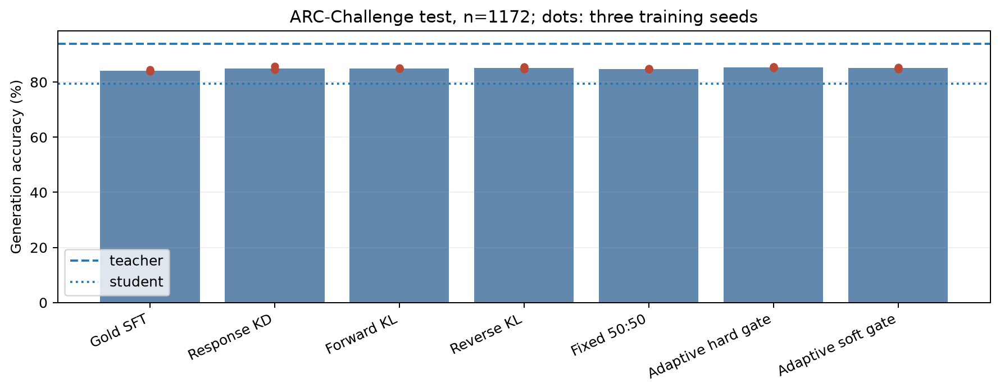
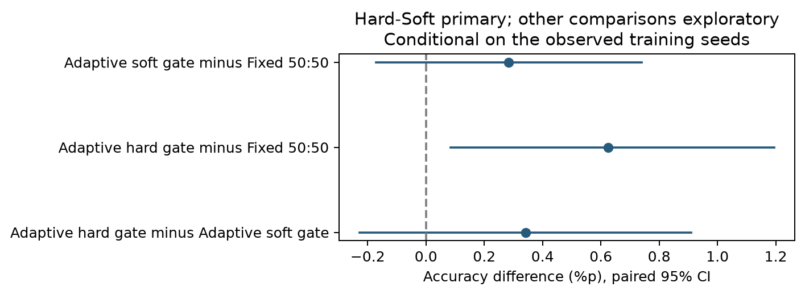
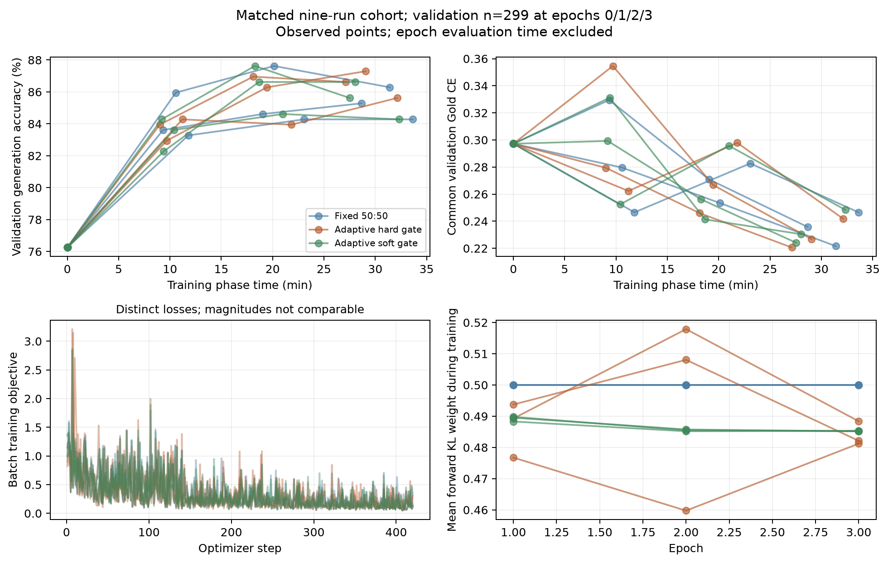
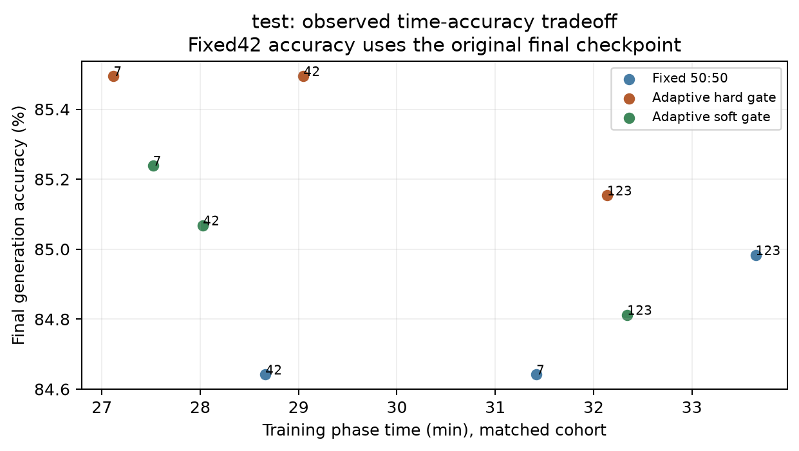
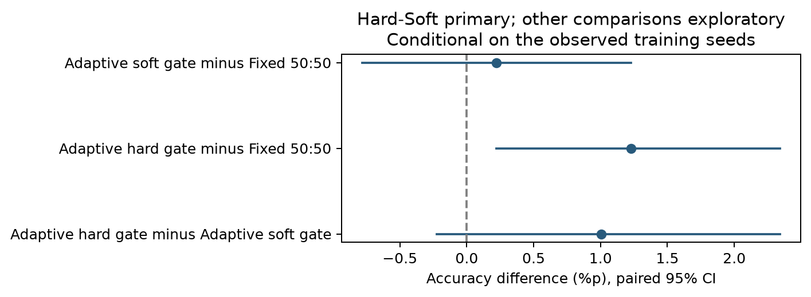

# 연구보고서 v4.3 · 증류 성능·시간 본실험 최종 결과

<!-- main-status:start -->
**v4.3 완료:** 본실험 21개 학습·validation과 Teacher·원본 Student·21개 adapter의 test 1,172개 평가 완료. Fixed seed 42 시간 재현 1회는 별도이며 원본 최종 checkpoint를 유지했다. Test 이후 재학습·checkpoint 변경은 수행하지 않았다.
<!-- main-status:end -->

<!-- gate-final-results:start -->
## v4.3 동결 test 최종 결과

Teacher 93.86%, 원본 Student 79.35%. 아래 세 seed의 SD와 paired 문항 CI는 서로 다른 불확실성이다.

| 조건 | Test Accuracy 평균±SD | seed 42 / 7 / 123 | 선택지 NLL |
|---|---|---|---|
| Gold SFT | 84.16±0.30% | 84.13% / 83.87% / 84.47% | 1.0417 |
| Response KD | 84.95±0.63% | 84.47% / 85.67% / 84.73% | 1.1187 |
| Forward KL | 84.98±0.15% | 84.90% / 84.90% / 85.15% | 0.4918 |
| Reverse KL | 85.18±0.40% | 84.73% / 85.49% / 85.32% | 0.5060 |
| Fixed 50:50 | 84.76±0.20% | 84.64% / 84.64% / 84.98% | 0.5004 |
| Adaptive hard gate | 85.38±0.20% | 85.49% / 85.49% / 85.15% | 0.4994 |
| Adaptive soft gate | 85.04±0.21% | 85.07% / 85.24% / 84.81% | 0.5064 |

| 비교 | Accuracy 차이 | paired 95% CI |
|---|---|---|
| Adaptive hard gate − Adaptive soft gate | +0.34%p | [-0.23, +0.91]%p |
| Adaptive hard gate − Fixed 50:50 | +0.63%p | [+0.08, +1.19]%p |
| Adaptive soft gate − Fixed 50:50 | +0.28%p | [-0.17, +0.74]%p |

주 비교의 CI가 0을 포함해 Hard와 Soft의 Accuracy 우위를 확인하지 못했다. 동등성을 입증한 것은 아니다. Hard−Fixed·Soft−Fixed는 사전 지정 보조 비교이며 미조정 탐색적 CI다. 모든 CI는 관측한 세 학습 seed에 조건부이며 seed 모집단까지 포괄하지 않는다.

| 측정 조건 | 학습 시간 평균±SD | seed 42 / 7 / 123 |
|---|---|---|
| Fixed 50:50 | 31.24±2.50분 | 28.66 / 31.42 / 33.65분 |
| Adaptive hard gate | 29.44±2.53분 | 29.05 / 27.12 / 32.14분 |
| Adaptive soft gate | 29.30±2.65분 | 28.03 / 27.52 / 32.34분 |

시간은 모델/Teacher/cache 로딩·epoch 진단·최종 평가를 제외하고 학습 loop·로그·최종 저장을 포함한다. 기존 E1~E4 시간은 다른 날짜의 기술적 참조이며 위 동일 측정 cohort와 직접 순위를 합치지 않는다. Fixed seed 42 시간은 재현 run, 최종 성능은 기존 adapter에서 측정했다. 재현 tensor hash 일치: True; final validation 답변 불일치: 0개.

**시간 해석 한계:** 공유 데스크톱에서 측정했고 다른 앱의 GPU 활동도 관측했다. 이전 run 전체의 부하 이력·영향은 미측정이므로 알고리즘 자체의 속도 우위를 분리한 결과로 주장하지 않는다. [관측 기록](../results/checks/timing_environment_snapshot.json)

전체 Teacher 준비 작업의 기존 시간은 hard 응답 생성과 soft 확률 추출을 함께 측정했으므로 소급 분리하지 않았다. 추론 지연은 고정 warmup 후 문항별 생성 측정이며 reference kernel 환경에 한정된다. 선택지 NLL·ECE·Brier·gate 분포·Teacher 오류 분모·자원 상세값은 [전체 결과](../results/gate_comparison_v4/test/comparison.json)에 보존한다. 공개 checkpoint의 ARC 사전 노출과 원문 실행 config의 scaling은 여전히 미검증이다.
<!-- gate-final-results:end -->

## 2026-10-12 계획 개정

사용자 제공 PDF에 따라 [연구계획서 v4.3](RESEARCH_PLAN.md)은 **Hard−Soft의 Accuracy·시간 효율성**을 주 연구로 하고 E7을 추가한 7조건×3 seeds로 개정했다. Fixed 대비 두 비교는 핵심 대조다. 2026-10-12 사용자 지적 후 원문을 대조해 임의 온도 선정·Soft detach를 철회했다. E7은 원문 sigmoid(confidence gap−m), m=0.05, selection gradient 유지로 수식을 구현했다. 새 7조건 실행기를 분리하고 원문 margin·gradient·시간 범위·전체 validation 관측 주기를 v4.3 프로토콜에 동결했다. 현재 실행 상태는 상단에, 실제 validation 중간 관측은 아래에 구분해 기록한다.

후반의 **기존 v3.2 절**에는 이전 6조건의 실험·수치·그래프를 보존한다. 기존 13회 학습·12회 검증은 새 동결 manifest에서 호환성 검사를 통과해 재사용한다. 동결 당시 추가 본실험 학습은 8회, 시간 측정용 Fixed seed 42 재현은 별도 1회로 계획했다. 기존 최종 adapter를 바꾸지 않고 원본 프로토콜과 산출물을 보존한다. [계획 변경 이력](../results/protocols/research_revision_v4.json)

## 2026-10-12 근거 대조 점검

CaRE-KD의 원본 PDF와 공개 HTML에서 gate 식·margin·selection gradient가 일치함을 확인했다. 공식 고정 revision의 9B·2B config는 로컬 cache와 byte 단위로 일치하며 공식 dataset card의 1,119/299/1,172 분할도 확인했다. 공개 Qwen checkpoint는 post-trained 모델이므로 원본 Student를 순수 pretraining Base 모델로 해석하지 않는다.

T=2·lr=2e−4·r=8·3 epochs·3 seeds는 기존 통제값이며 원문 default가 아니다. 첫 위치·EOS 손실도 과제 설계로 구분한다. 문헌 근거가 없는 목표 80%는 철회하고 정확도–시간 곡선과 총 학습 시간으로 비교한다. 5,000회 paired bootstrap은 기존 validation에서 재현됐으며 20,000회와의 Accuracy CI 끝점 차이는 최대 0.112%p였다. 최종 test나 학습 seed 불확실성에 대한 보장은 아니다. [근거·점검·조치 기록](../results/protocols/evidence_audit.json)

원문 PDF Figure 2의 개념도 기울기는 식 (3)의 unit sigmoid와 수치적으로 같지 않아 실제 코드의 scaling은 미확인으로 남겼다. 현재 구현은 공개 수식·gradient를 따르며 원문의 Soft 실험 설정을 정확히 재현했다고 주장하지 않는다. 그림에서 추가 온도를 생성하지 않았다.

### Soft GPU 검사 완료: 본실험과 분리

실제 NVIDIA GeForce RTX 5060 Ti에서 train 최장 입력 236 tokens, 전체 1,118개 prefix/cache 대응을 확인했다. 기존 설정의 8회 gradient 누적·1회 optimizer 갱신에서 유한한 loss/gradient와 LoRA 갱신을 확인했고 Teacher·원본 embedding은 동결됐다. Peak allocated VRAM은 3.69 GiB다. Adapter를 저장하거나 본학습에 재사용하지 않았으며 이것을 E7 완료 학습으로 세지 않는다. [실측 검사 결과](../results/checks/soft_gpu_probe.json)

`causal_conv1d`·`flash-linear-attention` 최적화 커널이 없어 실제 실행은 PyTorch reference fallback이었다. 계산 검사는 통과했지만 시간 결과는 이 고정 환경의 비교이며 최적 배포 속도로 일반화하지 않는다. 의존성이나 backend를 바꾸려면 시간 비교군 전체의 새 측정이 필요하다.

## v4.3 실행 동결·재개

22개 검사에서 기존 Fixed/Hard loss 호출 유지, 1,118개 문항 순서·140 steps/epoch, 마지막 6개 누적 gradient와 기존 optimizer 갱신 일치, 평가 RNG·모드 보존, 실패 run 덮어쓰기 방지를 확인했다. 새 Soft 학습 호출의 실제 GPU 검사도 8회 누적·1회 갱신을 통과했다. 검사 모델은 폐기했으며 학습 실적에 포함하지 않는다. [새 경로 검사](../results/checks/trainer_gpu_check.json)

원본 7개 소스·원본 프로토콜·130개 보호 산출물과 완료 adapter를 유지하고, 별도 v4 소스·runtime·설정·재사용 hash를 동결했다. 신규 학습 8회와 Fixed seed 42의 시간 측정 재현 1회를 순차 실행하도록 구성했다. 모든 epoch의 validation은 299개 전체이며, 저장한 최종 adapter를 다시 로딩해 검증한다. Fixed seed 42 성능 평가는 기존 adapter를 사용한다. [동결 manifest](../results/protocols/gate_training_protocol.json)

현재 GPU는 RTX 5060 Ti 16GB 1개, CPU는 Ryzen 5 7500F 6코어·12스레드다. 학습 시간의 비교 가능성을 위해 GPU 학습은 동시에 실행하지 않는다. 새 학습 실행기는 학습·validation 완료에서 종료하며, 별도 후속 프로세스가 test 동결·23개 모델 평가를 맡는다.

## v4.3 후속 평가 준비·학습 중간 관측

전체 33개 검사에서 test 조기 실행 차단, 21개 최종 adapter 검증·23개 평가 모델 구성, Fixed seed 42 재현 제외, 문항별 paired bootstrap, 보고서 재실행과 원본 보존을 확인했다. Test manifest 저장 경로 오류는 시험용 파일 검사에서 발견해 수정했으며 실제 baseline 기록은 변경되지 않았다. [후속 코드 검증](../results/checks/gate_evaluation_check.json)

평가 사전 동결 시점에 후속 프로세스를 학습·validation 완료를 기다리는 상태로 연결했다. 실행 순서는 모든 조건 검증 → checkpoint·소스·통계 동결 → 23개 모델 test → 통계·그림 → 문서 3개·Git 갱신이다. 예약 작업이나 heartbeat는 생성하지 않았다. 실제 test 진행 상태는 상단 snapshot에 표시한다. [평가·분석 사전 동결](../results/protocols/gate_evaluation_protocol.json)

## v4.3 전체 학습·validation 완료

<!-- validation-complete:start -->
7조건×3 seeds의 **본실험 21개**와 별도 Fixed seed 42 시간 재현 1회를 마쳤다. 아래는 **validation 299개**의 결과다. Teacher 92.64%, 원본 Student 76.25%. SD는 세 학습 seed의 표본 변동이며 문항 bootstrap CI와 구분한다.

| 조건 | Validation Accuracy 평균±SD | seed 42 / 7 / 123 | 선택지 NLL |
|---|---|---|---|
| Gold SFT | 85.28±1.21% | 84.28% / 86.62% / 84.95% | 0.9288 |
| Response KD | 86.29±1.67% | 87.96% / 86.29% / 84.62% | 0.9296 |
| Forward KL | 85.95±0.88% | 84.95% / 86.62% / 86.29% | 0.4475 |
| Reverse KL | 86.18±0.39% | 85.95% / 86.62% / 85.95% | 0.4738 |
| Fixed 50:50 | 85.28±1.00% | 85.28% / 86.29% / 84.28% | 0.4656 |
| Adaptive hard gate | 86.51±0.84% | 87.29% / 86.62% / 85.62% | 0.4601 |
| Adaptive soft gate | 85.51±1.17% | 86.62% / 85.62% / 84.28% | 0.4672 |

| Validation 비교 | Accuracy 차이 | paired 95% CI |
|---|---|---|
| Adaptive hard gate − Adaptive soft gate | +1.00%p | [-0.22, +2.34]%p |
| Adaptive hard gate − Fixed 50:50 | +1.23%p | [+0.22, +2.34]%p |
| Adaptive soft gate − Fixed 50:50 | +0.22%p | [-0.78, +1.23]%p |

주 비교 Hard−Soft의 CI는 0을 포함한다. Validation에서 우위를 확정하지 못했고 동등성을 입증한 것도 아니다. Hard−Fixed의 양의 구간은 사전 지정 보조 비교의 **미조정 탐색적 validation 결과**다. 모든 구간은 관측한 세 seed에 조건부이며, 최종 결론은 동결한 test 전체 결과에서 별도로 보고한다.

| 측정 조건 | 학생 학습 단계 시간 평균±SD | seed 42 / 7 / 123 |
|---|---|---|
| Fixed 50:50 | 31.24±2.50분 | 28.66 / 31.42 / 33.65분 |
| Adaptive hard gate | 29.44±2.53분 | 29.05 / 27.12 / 32.14분 |
| Adaptive soft gate | 29.30±2.65분 | 28.03 / 27.52 / 32.34분 |

학생 학습 단계 시간은 loop·로그·최종 저장을 포함하고 모델/Teacher/cache 로딩·epoch 진단·최종 평가를 제외한다. Fixed seed 42의 시간·곡선은 재현 run이고 최종 성능 checkpoint는 원본이다. 재현 tensor hash·420-step 학습 기록이 원본과 일치하고 최종 299개 답변도 일치했다. E1~E4의 과거 시간은 이 측정 cohort와 직접 합쳐 순위를 매기지 않는다.

**시간 해석 한계:** 공유 데스크톱의 실측값이다. 다른 앱의 GPU 활동을 한 번 관측했고 이전 run 전체의 부하 이력·영향은 측정하지 않았다. 알고리즘 자체의 속도 우위나 전용 GPU 성능을 분리한 결과로 주장하지 않는다. [관측값·한계](../results/checks/timing_environment_snapshot.json)

곡선은 epoch 0·1·2·3의 전체 validation 관측과 실제 학습 시간을 사용했다. 각 손실의 크기를 서로 비교해 우열을 판단하지 않는다. 세 조건은 seed별 초기 adapter·문항 순서·학습률이 같고 420 steps·3,354 forward를 수행했다. 마지막 누적 batch는 매 epoch 6개이며 finite loss·gradient·gate 수식과 저장 후 299개 답변 일치를 검증했다. 일부 seed에서 마지막 epoch 정확도가 내려갔지만 모든 조건에서 고정 epoch 3을 유지했다.

[전체 결과·gate·오류 분모·hash](../results/gate_comparison_v4/validation/comparison.json) · [7조건 Accuracy 그림](../results/gate_comparison_v4/validation/accuracy.png) · [시간–정확도 그림](../results/gate_comparison_v4/validation/time_accuracy.png). 이전 seed별 관측은 [seed 42](../results/gate_comparison_v4/progress/seed42_validation_curves.json)·[seed 7](../results/gate_comparison_v4/progress/seed7_validation_curves.json)·[Soft seed 123](../results/checks/gate_soft123_progress.json)에 보존한다.

Teacher 준비의 기존 시간은 hard 응답 생성과 soft 확률 추출의 합산 구간이다. 두 비용을 소급 분리하거나 각각 실측했다고 표기하지 않는다. 최종 23개 모델과 통계·소스는 [test 동결 manifest](../results/protocols/gate_test_manifest.json)로 고정했으며 이후 재학습·checkpoint 변경 없이 평가만 진행한다.
<!-- validation-complete:end -->

## 재현 설정·준비 신호

| 항목 | 완료된 실험 설정 |
|---|---|
| 모델 | Qwen3.5-9B NF4 double quant·BF16 compute Teacher / Qwen3.5-2B BF16·FP32 LoRA Student |
| 입력 | ARC-Challenge train 1,118·validation 299·test 1,172; 원본 ID·전체 입력 hash 교집합 0 |
| 반복 | 7조건×seed 42·7·123, 원본 Student부터 각각 3 epochs·420 steps, 고정 epoch 3 |
| 학습 대상 | Student LoRA 8,409,600개 parameter; Teacher·Student 원본 가중치 동결 |
| 증류 범위 | KL 5조건은 T=2 전체 어휘의 첫 답변 위치와 공통 EOS CE; Gold·Response는 hard label CE |

Teacher 전체 train 신호는 1,118개이며 1,066개(95.35%)가 정답과 일치했다. 오답 52개도 유지했고 형식 오류·잘림은 0건이다. FP32 log-probability cache는 1,110,487,136 bytes(약 1.03 GiB)다. Gold는 실제 정답 SFT, Response는 Teacher 답변 SFT이며 KL 조건은 확률분포를 비교한다. Hard는 상대 entropy confidence로 한 방향을 선택하고, Soft는 sigmoid(confidence 차이−0.05)와 selection gradient를 사용한다. Gate를 정답 판별기나 Teacher 오류 필터로 해석하지 않는다. [7조건의 수식·차이](RESEARCH_PLAN.md#methods) · [Teacher 준비 기록](../results/protocols/teacher_targets_summary.json) · [입력 기록](../results/protocols/data_manifest.json)

## Teacher 오류와 확률 품질: 보조 해석

Test의 Teacher 오답은 **72개**, 이 중 원본 Student가 맞힌 것은 **17개**다. Hard는 seed별 Teacher 오답 26·26·26개를 맞혔고 원본 정답 5·6·5개를 잃었다. Soft는 25·26·25개를 맞혔고 7·6·6개를 잃었다. 같은 문항의 반복 관측과 작은 subset이므로 이 수치로 오류 전달의 인과 효과나 gate의 오류 방지 능력을 입증하지 않는다.

Gold·Response의 평균 선택지 NLL은 1.0417·1.1187이고 KL 다섯 조건은 0.4918~0.5064다. 관측한 정답률과 확률 품질이 다른 결론을 낼 수 있으므로 구분해 보고한다. 이 보조 지표를 Hard−Soft Accuracy 주 비교의 성공으로 대체하지 않는다. [세부 NLL·Brier·ECE·gate·오류 분모](../results/gate_comparison_v4/test/comparison.json)

## 이전 실험 보존

v3.2의 완료 학습 13회와 validation 12회는 설정·초기화·문항 순서·모델·데이터·adapter hash 호환성을 확인해 재사용했다. 중단한 Fixed 파일럿(64/96 steps)은 완료 모델로 쓰지 않았다. 과거의 미완료 표·중간 관측은 Git 이력과 원본 수치에 보존하고 본문에서는 최종 v4.3 결과와 구분했다.

[과거 본실험 중간 수치](../results/main/comparison.json) · [파일럿 수치](../results/pilot/comparison.json) · [파일럿 곡선](../results/pilot/index.html) · [원본 보존 기록](../results/protocols/scope_change.json)

## 결과 범위·종료 검증

주 비교는 Hard−Soft Accuracy +0.34%p, 조건부 95% CI [−0.23,+0.91]%p로 우위를 확인하지 못했다. Hard−Fixed의 +0.63%p, [+0.08,+1.19]%p는 미조정 탐색적 보조 결과다. 이번 수치로 보편적 우위나 동등성, smoothing만의 인과 효과를 주장하지 않는다. 공개 checkpoint의 ARC 사전 노출과 원문 공식 실행 config의 scaling은 미검증이다.

21개 학습·validation과 23개 test의 문항·정답·확률·checkpoint hash를 검증했다. 5,000회 bootstrap의 전체 집계·CI가 재현됐고 문항별 세 seed 평균을 직접 재표집한 독립 계산도 Accuracy CI와 일치했다. 최종 그림 4개를 확인했으며 보호 원본 130개·동결 소스 12개·공개 checkpoint hash가 유지됐다. Test 이후 재학습·checkpoint 변경은 수행하지 않았다. [최종 검증 기록](../results/checks/gate_final_verification.json)

다른 모델·데이터로의 일반화, 전용 GPU에서의 속도 비교, 원문 전체 프레임워크 재현은 이번 실험에서 확인하지 않았다.

## 다른 계열 확장 준비: 2026-10-13

MiniLLM·DSKD·ULD·Few-Shot MCQA Distillation의 본문·부록을 대조했다. MiniLLM/DSKD의 명시된 5 seeds는 decoding 반복이며 독립 학습 5회로 쓰지 않는다. MCQA 논문은 전체 실험 5개 random seed 평균을 명시하므로 **학습 1 seed가 논문 표준이라는 근거는 없다**. 한 seed 확장은 탐색 예산으로 구분한다. [출처·해석 기록](../results/protocols/cross_family_evidence.json)

후속안은 공통 선택지 확률에서 Qwen2B·SmolLM2-1.7B의 Fixed·Hard·Soft × seed 42, 총 6회다. 새 Qwen 대조가 있어야 기존 전체 어휘 KD와 새 선택지 KD의 차이를 Student 계열 효과로 오해하지 않는다. 이 안은 원문 CaRE/DSKD/ULD의 전체 재현이 아니며 새 선택지 분류 Accuracy도 기존 생성 Accuracy와 별도로 보고한다. [구체적인 확장안·반복 정책](RESEARCH_PLAN.md#9-다른-계열-확장안-문헌-대조선행-검사-2026-10-13)

공식 API/config·tokenizer 고정 revision 검사와 train/validation 1,417개 전체의 답변 token·prefix 대응을 통과했다. SmolLM2의 원본 safetensors는 3,422,777,952 bytes(약 3.19 GiB), SmolLM3는 약 5.73 GiB로 확인했으며 추론/학습 VRAM과 다른 값이다. 가중치 다운로드·새 모델 benchmark·GPU 학습은 수행하지 않았다. 동결 소스 12개와 보호 산출물 130개의 hash는 모두 유지됐다.
